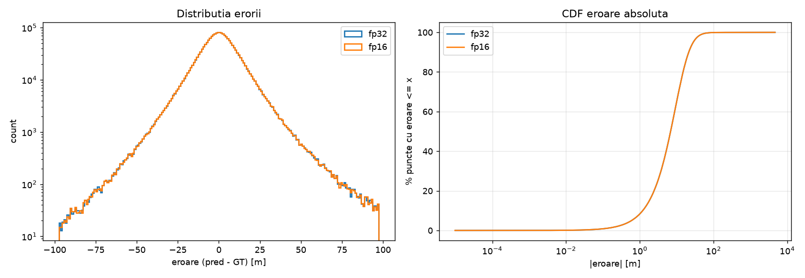
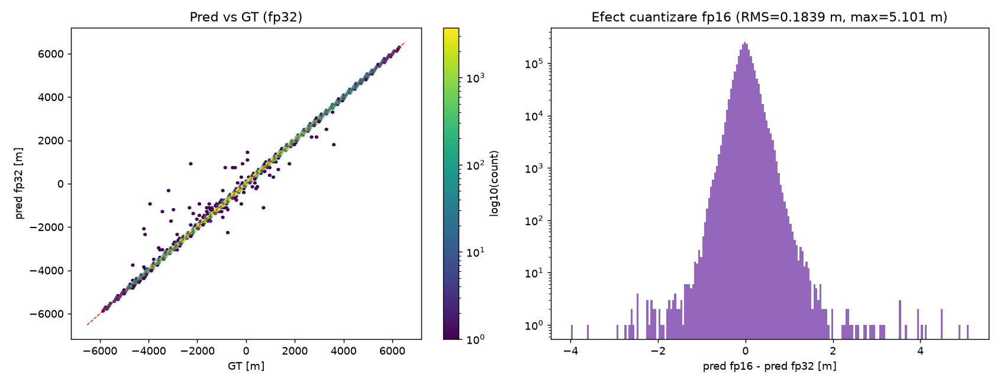
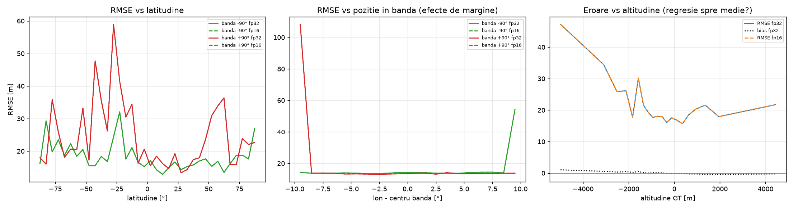
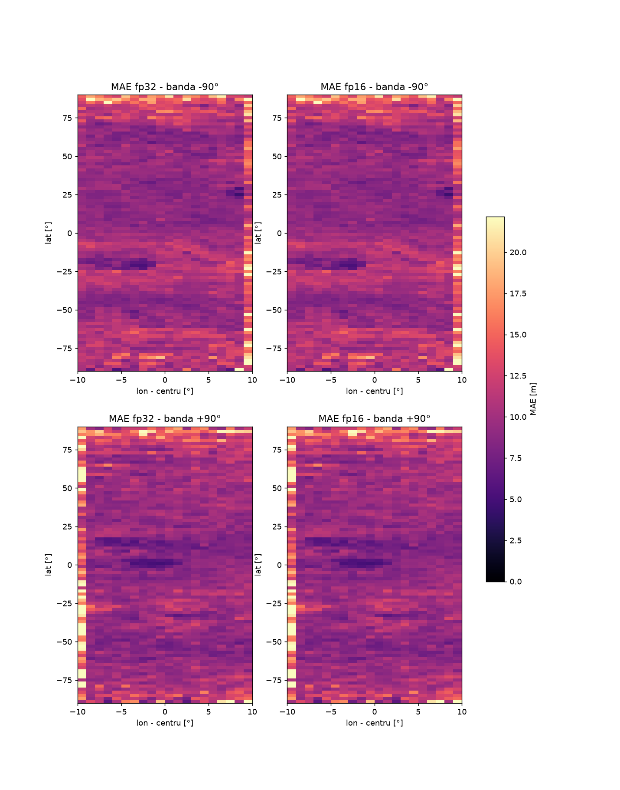
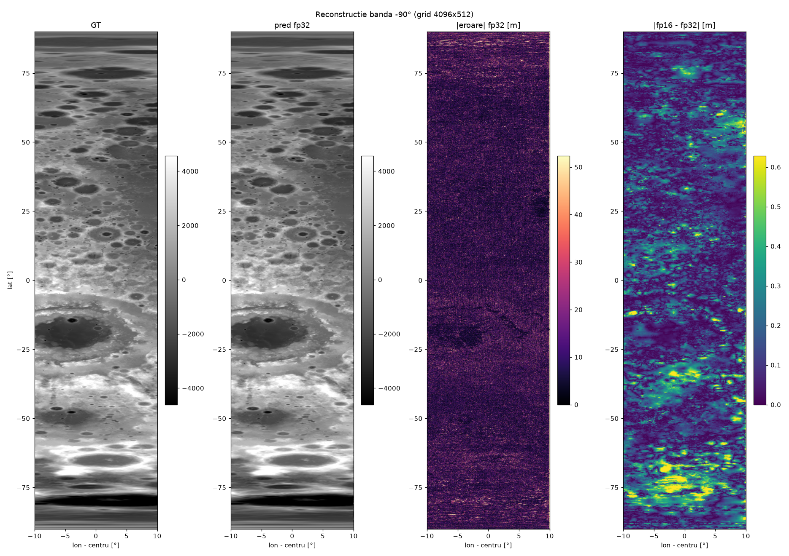
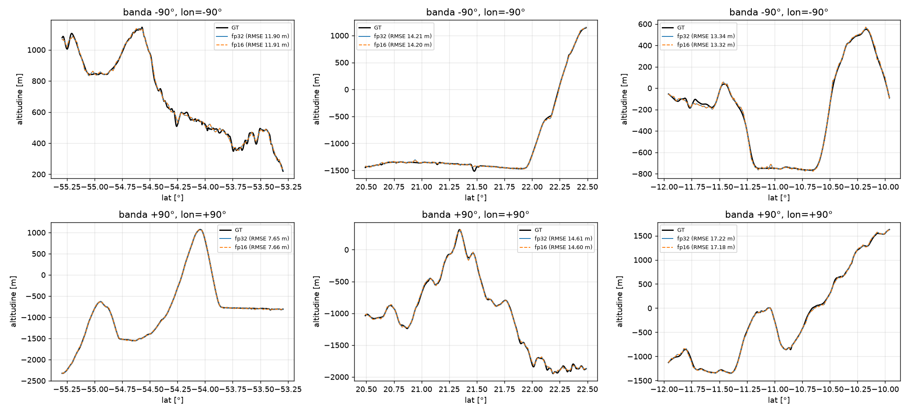

# 🌙 Lunar Limb Elevation Model

Neural network that maps **selenographic coordinates (longitude, latitude) → lunar surface elevation**, used by the 3D Eclipse Simulator to model the real (non-circular) edge of the Moon. It feeds the limb-corrected contact times **C1L–C4L**, the corrected maximum **MAXL** and the **Lunar Limb Duration**.

The network is fitted on the **NASA LRO / LOLA global lunar DEM** (LDEM, 118 m/pixel, March 2014 release, USGS Astrogeology Science Center). It compresses a ~8 GB DEM into a **67 MB** (fp16) model that can be queried in real time at any point, with no tiling or loading.

| | |
|---|---|
| **Final model** | `Content/Encoder/lunar_altitude_contact_bands_fp16_finetuned.pt` (67 MB, fp16) |
| **Validation RMSE** | **12.57 m** vs. the LOLA DEM (see [Evaluation](#-evaluation)) |
| **First iteration (SIREN)** | ~42 m RMSE |

---

## Model

| Component | Choice |
|---|---|
| Input | `(u, v)`: normalized position inside one of two longitude bands, and normalized latitude |
| Encoding | Multi-resolution **hash grid**, 20 levels × 2 features, table size 2²¹, finest resolution 46,080 cells in latitude (≈118 m, the native DEM resolution) |
| Decoder | MLP, 3 hidden layers × 256, GELU (as defined in `Fine_tuning_lunar_model.py`) |
| Output | Normalized elevation, de-normalized with `alt_mean` / `alt_std` stored in the checkpoint |
| Storage | fp16 embeddings for deployment (loaded into fp32 for inference), fp32 for training |

**Training domain.** Contact points lie near the lunar limb, around ±90° selenographic longitude. Only two bands of **±10°** around −90° and +90° are modeled (≈ 11.1 % of the surface), so the whole parameter budget goes where the limb profile matters. The two bands are mapped to the two halves of the `u` axis, with no wrap-around between them.

**Why a hash grid instead of SIREN.** The first iteration used a SIREN (sinusoidal MLP) and plateaued at ~42 m RMSE, too coarse when contact-time corrections depend on elevation differences of tens of metres. The multi-resolution hash grid lets the high-resolution levels capture craters and ridges while the MLP stays small.

---

## Training recipe

Training has two stages.

### Stage 1: base training (`Antrenare_model_5.py`)

| Setting | Value |
|---|---|
| Optimizer | Adam, lr 5e-3, cosine annealing, mixed precision (AMP) |
| Budget | up to 2,000 epochs × 2 M samples, batch 16,384, early stopping (patience 50) |
| Coarse-to-fine | hash-grid levels activated progressively over the first 40 % of epochs |
| Curvature-biased sampling | up to 60 % of each batch drawn from high-curvature regions |
| Curvature-weighted loss | MSE with per-sample weight up to 5× on peaks and ridges |
| Gradient (slope) loss | predicted slopes vs. DEM slopes via finite differences, with metric scale and cos(lat) correction; ramped in after the network reaches full resolution (λ = 0.05) |

Outputs `*.pt` (fp32) and `*_fp16.pt` checkpoints (paths set at the top of the script).

### Stage 2: fine-tuning (`Fine_tuning_lunar_model.py`)

Continues from the stage-1 checkpoint (`CHECKPOINT_PATH_IN`, the ~13 m model) with a very small learning rate.

| Setting | Value |
|---|---|
| Optimizer | Adam, lr 1e-6, cosine annealing |
| Budget | up to 600 epochs, early stopping (patience 60) |
| Loss | Huber (δ = 1.0) |
| Sampling | 60 % curvature-biased from the first epoch, all levels active (no warm-up) |
| Normalization | `alt_mean` / `alt_std` are copied from the input checkpoint so the scale stays identical |

The final model is the output `lunar_altitude_contact_bands_fp16_finetuned.pt`.

### Progress

| Stage | Val RMSE |
|---|:---:|
| SIREN (first design) | ~42 m |
| Hash grid, intermediate | ~22 m → ~13 m |
| Hash grid + fine-tuning (final) | **12.57 m** |

---

## Reproduce

### 1. Install

```bash
pip install -r requirements.txt
```

Training needs a CUDA GPU (CPU works, but is very slow) and **plenty of RAM**: the DEM is read as float32 (~17 GB for the full 92,160 × 46,080 raster). 32 GB RAM is recommended.

### 2. Get the DEM

Download LDEM 118 m (Simple Cylindrical, 256 px/degree, elevations relative to the 1,737.4 km lunar reference sphere) from the
[USGS Astrogeology Science Center](https://astrogeology.usgs.gov/search/map/moon_lro_lola_dem_118m)
and save it as `lunar_dem.tif` in the folder you run the scripts from. The DEM is **not** included in the repository.

### 3. Train and fine-tune

The scripts use relative paths, so run them from the folder that contains `lunar_dem.tif`.

```bash
python -u Antrenare_model_5.py          # stage 1
# set CHECKPOINT_PATH_IN in Fine_tuning_lunar_model.py to the stage-1 output, then:
python -u Fine_tuning_lunar_model.py    # stage 2
```

### 4. Evaluate

Edit the `CONFIG` block at the top of `Testare_model_2.py` (checkpoint names, number of test samples), then:

```bash
python Testare_model_2.py
```

The script finds the training file whose architecture matches the checkpoint, evaluates fp32 and fp16 side by side and writes plots and `metrics.json` to `eval_out/`.

---

## Evaluation

`Testare_model_2.py` reports, for both fp32 and fp16 and on a uniform and a curvature-focused test set: RMSE, MAE, bias, percentiles (P50–P99.9), max error, R², the share of points under 1–50 m, per-band results, a slope (gradient) test, and the fp16-vs-fp32 quantization effect. Full numbers: [`eval_out/metrics.json`](eval_out/metrics.json).

| | |
|---|---|
|  |  |
| Error distribution and CDF | Prediction vs. DEM, fp16 quantization effect |
|  |  |
| Error vs. latitude, band position, altitude | Error heatmaps per band |
|  |  |
| Reconstruction of the −90° band | Limb profiles: model vs. DEM |

> Note: the "RMSE" printed during training is derived from the training loss, not a true RMSE. The evaluation script computes the real RMSE in metres on held-out samples.

---

## Using the model

```python
import numpy as np, torch
from Fine_tuning_lunar_model import LunarAltitudeContactBandsNet   # importing does not start training

ck = torch.load("lunar_altitude_contact_bands_fp16_finetuned.pt",
                map_location="cpu", weights_only=False)
model = LunarAltitudeContactBandsNet(ck["recommended_lon_cells"])
model.load_state_dict(ck["model_state"])        # fp16 embeddings are cast to fp32
model.eval()

def elevation_m(lon_deg, lat_deg):
    """Elevation (m, relative to the 1737.4 km sphere) at selenographic lon/lat near ±90°."""
    centers, w = np.array(ck["limb_centers_deg"]), ck["band_half_width_deg"]
    lon = np.atleast_1d(np.asarray(lon_deg, dtype=np.float64))
    lat = np.atleast_1d(np.asarray(lat_deg, dtype=np.float64))
    tile = np.argmin(np.abs(((lon[:, None] - centers + 180) % 360) - 180), axis=1)
    delta = ((lon - centers[tile] + 180) % 360) - 180
    if np.any(np.abs(delta) > w):
        raise ValueError("Point outside the trained longitude bands")
    u = (tile + (delta + w) / (2 * w)) / 2.0
    v = (lat - ck["lat_min"]) / (ck["lat_max"] - ck["lat_min"])
    with torch.no_grad():
        p = model(torch.tensor(u, dtype=torch.float32), torch.tensor(v, dtype=torch.float32))
    return p.numpy() * ck["alt_std"] + ck["alt_mean"]

print(elevation_m(90.0, 10.0))
```

In the simulator, `Server.py` loads the same checkpoint once at startup (`torch.load`, CPU).

---

## Limitations

- Only two ±10° longitude bands around ±90° are trained. Queries outside them are outside the model's domain.
- The RMSE is measured against the gridded LOLA DEM (118 m/pixel), not the true lunar surface. Features smaller than the DEM resolution are not represented.

## Data

LRO / LOLA LDEM 118 m, via the USGS Astrogeology Science Center. See [`docs/THIRD_PARTY.md`](../docs/THIRD_PARTY.md).