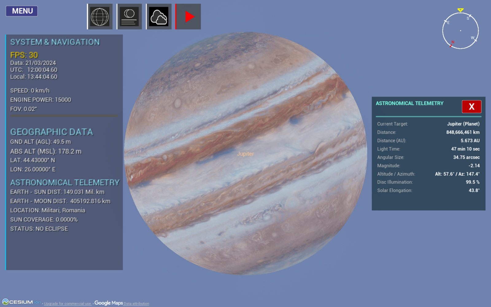

<div align="center">

<!-- Replace with your best screenshot / GIF: the shadow cone over Earth -->


# 🌑 Eclipse Simulator 3D

### See the geometry of an eclipse — not just a shaded band on a map.

A real-time **3D solar eclipse simulator** that renders the **umbra and penumbra as physical cones** sweeping across a geographically accurate Earth.
Built with **Unreal Engine 5**, **Cesium** photorealistic terrain and a **Python / Skyfield** backend driven by **JPL DE441** ephemerides.

[](https://www.unrealengine.com/)
[](#-how-it-works)
[](https://www.python.org/)
[](https://rhodesmill.org/skyfield/)
[](https://cesium.com/)
[](#-requirements)
[](LICENSE)

**[▶ Demo 1](YOUTUBE_LINK_1)** · **[▶ Demo 2](YOUTUBE_LINK_2)** · **[⬇ Gumroad](GUMROAD_LINK)** · **[🎮 itch.io](ITCH_LINK)**

</div>

<br>

| 🕰️ **30,000 years** | ☀️ **71,264 solar eclipses** | ⏱️ **≤ 1.5 s** vs. reference | ⭐ **5,079 stars** | 🎞️ **~60 FPS** |
|:---:|:---:|:---:|:---:|:---:|
| 13,000 BC → 17,000 AD | Irwin 2021 catalogue | C1–C4 contact times | HYG 4.2, magnitude < 6 | photorealistic terrain |

---

## 📖 Contents

[Why](#-why-this-project) · [Features](#-features) · [Gallery](#-gallery) · [Demos](#-demo-videos) · [Download](#-download) · [Build from source](#-getting-started-build-from-source) · [How it works](#-how-it-works) · [Eclipse types](#-eclipse-types) · [Case studies](#-case-studies) · [Validation](#-validation--accuracy) · [Comparison](#-comparison-with-other-tools) · [Limitations](#-limitations) · [FAQ](#-faq) · [Roadmap](#-roadmap) · [Timeline](#-project-timeline) · [Credits](#-credits--acknowledgements) · [Cite](#-how-to-cite) · [License](#-license)

---

## 🎯 Why this project?

If you look at the tools available to researchers, educators and eclipse chasers, most of them are limited to **2D visualizations** (maps with shaded bands) or output **tabular data** (contact times, coordinates, durations). What is largely missing is a way to *see* the geometry of an eclipse: the umbra and penumbra as three-dimensional cones sweeping across a real Earth.

Eclipse Simulator 3D combines, to the best of my knowledge for the first time in this form:

1. the real-time graphics of **Unreal Engine 5**,
2. geospatial, photorealistic terrain from **Cesium**,
3. the astronomical precision of the **JPL DE441** ephemerides.

It started as my Bachelor's thesis, *"Real Shadow Cones Produced During the Central Solar Eclipse (Total Solar Eclipse and Annular Solar Eclipse)"*, at the **Faculty of Automatic Control and Computers, National University of Science and Technology Politehnica Bucharest**, and is now released as open source.

### Who is it for?

| 🎓 Educators, students, planetariums | 📷 Eclipse chasers & photographers |
|---|---|
| A fully immersive 3D alternative to static 2D maps. Simulate an eclipse from **any point on Earth, at any moment in 30 millennia**, and understand *why* it looks the way it does. Designed with integration into modern planetariums in mind. | Detailed calculations for **every eclipse** in the range, plus shadow geometry and **azimuth / altitude** for each contact — directly useful for positioning and calibrating optical equipment. |

---

## ✨ Features

**Astronomy & geometry**
- 🌍 **All four eclipse types** — total, annular, hybrid and partial — classified purely from geometry, not hard-coded rules.
- 🔺 **True 3D umbra & penumbra cones**, with the Earth modeled as a **WGS84 ellipsoid** (not a sphere), so the equatorial bulge — which measurably shifts where the shadow meets the surface, especially near the poles — is accounted for.
- 🛣️ **Path of totality / annularity rendered as a real 3D band** on Cesium terrain, not a flat 2D overlay.
- ⏱️ **Precise contact times C1–C4** with altitude and azimuth for each, computed by iterative root-finding. Edge cases are handled too, e.g. an extra **"Sunset"** row when the Sun sets before C4.
- 📚 **71,264 solar eclipses** (13,000 BC → 17,000 AD) built on the John Irwin 2021 catalogue, with a searchable / filterable / sortable catalogue browser, plus lunar eclipse support.
- 🪐 **Beyond Earth–Moon**: planets and major moons (Galilean moons, Titan, Triton…) tracked with the same DE441 ephemerides.

**Experience**
- 🚁 **Drone camera & free flight** — from orbit to street level with no loading interruptions.
- ⭐ **Accurate night sky** — 5,079 naked-eye stars (HYG 4.2), constellation lines & names, and optional mythological constellation artwork.
- 📡 **Live telemetry** — Earth–Sun / Earth–Moon distance, angular size, azimuth, altitude, magnitude, light time, solar elongation, coverage and status ("totality inside"…).
- 🕒 **Time Control panel** — calendar, UTC / solar time, play, pause, rewind, speed multipliers.
- 🔖 **Saved Locations** — bookmarks with title, notes, date/time, GPS coordinates, optical zoom and tracking settings.
- 🎨 **Visual effects & atmosphere** — bloom, star brightness, corona, exposure, clouds, fog, rain and snow, all independent of the astronomical computation.
- 🖍️ **Customizable overlays** — stars, planets, names, constellation lines, 2D ground projection or full 3D cones, with custom umbra / penumbra colors.
- 🌐 **Bilingual** reports and UI: English and Romanian.

---

## 🖼️ Gallery

<!-- Put your images in docs/images/ and update the file names below -->

| Shadow cone in 3D (12 Aug 2026) | Inside the umbra, 30 km over Tunis |
|---|---|
|  |  |
| **3D globe with totality band** | **Catalogue browser** |
|  |  |
| **Annular "ring of fire" — Istanbul, 2030** | **Night sky over Bucharest** |
|  |  |
| **Saturn & Titan** | **Jupiter & Io** |
|  |  |

> 📷 The real photographs of the **12 August 2026** total eclipse (Zaragoza and Sant Elm, Mallorca) were taken by the author.

---

## 🎬 Demo videos

| | |
|---|---|
| **Demo 1 — TITLE** | [](YOUTUBE_LINK_1) |
| **Demo 2 — TITLE** | [](YOUTUBE_LINK_2) |

<details>
<summary><b>🎞️ What the demos walk through</b></summary>

| Scenario | Highlights |
|---|---|
| **13,000 BC** — total eclipse | Extreme historical case: catalogue → teleport → drone flight to maximum totality, telemetry, contact table, totality band across Greenland |
| **11 Aug 1999** | Totality over Europe; flight to Bucharest to show *what if it had passed over the city*; free flight at speed; un-eclipsed Sun for contrast (magnitude −26.74) |
| **12 Aug 2026** | Iceland → northern Spain, diamond-ring effect, extra *Sunset* row in the contact table |
| **2 Aug 2027** — Luxor | 6 min 20 s totality, Zaragoza comparison, Nile, custom penumbra color |
| **1 Jun 2030** — annular | Ring of fire over Istanbul, Time Control panel, near-apogee Moon (> 400,000 km) |
| **Year 16,998** | Far-future totality over the Pacific; sunset with partial eclipse on the US west coast |
| **Solar system** | Space → street level over Bucharest, Jupiter's moons, Triton (> 4.6 billion km, 4 h 16 min light time), Mercury |
| **Night sky** | Overlays & Visuals panel, mythological constellations, Moon close-up, daytime stars |
| **Weather & bookmarks** | Cloud / fog / rain / snow, Saved Locations |

</details>

---

## ⬇️ Download

Don't want to build from source? Grab a ready-to-run build:

| 🛒 Gumroad | 🎮 itch.io |
|---|---|
| [**Download on Gumroad**](GUMROAD_LINK) | [**Download on itch.io**](ITCH_LINK) |

---

## 🚀 Getting started (build from source)

### 🧰 Requirements

- Windows 10/11 with a DirectX 12-capable GPU
- **Unreal Engine 5** (VERSION) with the **Cesium for Unreal** plugin
- **Visual Studio** with the *Game development with C++* workload
- **Python 3.x**
- ~5 GB free disk space for the ephemerides (`de441.bsp` alone is 3.2 GB)
- A free **Cesium ion** access token (the app asks for it on first run)

### 📦 Installation

**1️⃣ Clone the repository**

```bash
git clone https://github.com/Dragos112358/Eclipse-Simulator-3D.git
cd Eclipse-Simulator-3D
```

**2️⃣ Add the Encoder runtime**

Open the [**Releases**](https://github.com/Dragos112358/Eclipse-Simulator-3D/releases) page, download
[`Eclipse-Simulator-Encoder-win64.zip`](https://github.com/Dragos112358/Eclipse-Simulator-3D/releases/download/v1.0.0/Eclipse-Simulator-Encoder-win64.zip),
unzip it and copy its contents into the **repository root**.
This creates the `Content/Encoder/_internal` folder, which is required for the server to run correctly.

**3️⃣ Download the ephemerides**

```bash
python3 Download_Ephemerides/Downloader.py
```

> ⏳ `de441.bsp` is **3.2 GB**, so it is downloaded in **two parts** and then merged with `spkmerge`.
> This can take **up to an hour**, depending on your machine and internet connection.
> The script also downloads a high-quality Moon texture.

**4️⃣ Generate the Visual Studio project files**

Right-click **`Proiect_Eclipsa.uproject`** → **Generate Visual Studio project files**.

**5️⃣ Build & edit**

Open the generated **`.sln`** file in Visual Studio to build, modify and edit the code.

### 🐍 Backend server

The Python backend lives in [`Server/`](Server):

```bash
pip install -r Server/requirements.txt
```

<!-- TODO: add the exact command that starts the server (e.g. python Server/main.py) -->

### 📂 Repository layout

| Path | Contents |
|---|---|
| `Source/` | Unreal Engine C++ source (frontend, UI, drone camera, rendering) |
| `Content/` | Unreal assets (and `Encoder/_internal` after step 2) |
| `Config/` | Unreal project configuration |
| `Server/` | Python backend (Skyfield, geometry, UDP server) |
| `Download_Ephemerides/` | Script that fetches DE441 and the Moon texture |
| `Proiect_Eclipsa.uproject` | Unreal Engine project file |

---

## 🧠 How it works

### Two-tier architecture

```
┌──────────────────────────────┐    UDP · 80 B request / frame     ┌────────────────────────────────┐
│  Unreal Engine 5  (frontend) │ ────────────────────────────────▶ │  Python  (computational backend)│
│  Rendering · UI · Cesium     │                                   │  Skyfield · DE441 · GeoPy       │
│  Drone camera · VFX · HUD    │ ◀──────────────────────────────── │  Multithreaded                  │
└──────────────────────────────┘    UDP · 3,700 B response / frame └────────────────────────────────┘
```

**Why UDP?** The backend streams fresh celestial positions every frame. If a packet is dropped, the next one — a few milliseconds later — already supersedes it, so TCP's retransmission and ordering would only add latency. UDP also keeps the door open for running the backend remotely (e.g. offloading heavy computations to a server) without a rewrite.

**Why multithreaded?** The *main thread* computes body positions every frame and must never block. A *secondary thread* handles heavy or high-latency work — iterative contact-time root-finding and GeoPy location lookups — so the render loop never stutters.

### Computation pipeline

| # | Stage | What happens |
|---|---|---|
| 1 | **Time synchronization** | `finals2000A.all` provides Earth Orientation Parameters for ΔT and Earth's rotational irregularities, shared by the Python backend and the C++ frontend. |
| 2 | **Ephemerides** | JPL **DE441** is loaded through Skyfield; objects are instantiated for the Sun, Moon, Earth and the barycenters of the other planets. |
| 3 | **Shadow vector** | The cone axis `z_dir` is derived from the apparent Sun/Moon coordinates after transforming them into **ITRS** (Earth-fixed), so the shadow can be projected on the *rotating* Earth. |
| 4 | **Intersection modeling** | Given the axis and the umbra/penumbra angular radii, a **quadratic equation** gives the entry and exit points of the cone on the **WGS84 ellipsoid**. |
| 5 | **Contact times** | C1–C4 are found by iterative root-finding on the secondary thread. |

### Fixed-layout binary packets

| Direction | `struct` format | Size | Content |
|---|---|---|---|
| **Python → Unreal** | `350d900s` | **3,700 B** | Sun & Moon positions, coverage & magnitude, sidereal time (56 B) · planets (168 B) and major satellites (144 B) · **200 lat/lon path points** (1,600 B) + path width at each point (800 B) · live shadow position (16 B) · 900-byte UTF-8 report text (location names, contact times…) |
| **Unreal → Python** | `10d` | **80 B** | Year, month, day, hour, minute, precise seconds · observer latitude, longitude, altitude (WGS84) · language flag (`0` = Romanian, `1` = English) |

A fixed binary layout (instead of JSON) lets Unreal read every field directly by byte offset — no allocation or parsing, sixty times a second. The path-width array is what lets Unreal render the totality band as a **curved 3D mesh** instead of a fixed-width strip.

### Time scale & calendars

- **ΔT** uses the **Espenak & Meeus** piecewise polynomials, implemented identically in Python and C++ to avoid round-trip timing errors for ancient dates.
- **Calendar reconciliation:** Skyfield uses the *proleptic Gregorian* calendar, while the Irwin catalogue reports ancient dates in the *Julian* calendar. The two diverge by a growing number of days the further back you go; left unhandled, an ancient eclipse is silently mis-dated and its computed path lands in the wrong place. This is handled explicitly.

---

## 🌓 Eclipse types

| Type | Geometry | Example in the thesis |
|---|---|---|
| **Total** | The Moon's umbra reaches the Earth's surface and completely blocks the Sun | 21 Aug 2017, USA |
| **Annular** | Moon near apogee — the umbra falls short of the surface; a "ring of fire" remains | 1 Jun 2030, Istanbul |
| **Hybrid** | Because of Earth's curvature, the eclipse is total along part of its path and annular along another (~11 per century on average) | 25 Nov 2049, Sumatra |
| **Partial** | Only the penumbra sweeps over the observer | 14 Jan 2029, Vancouver |

---

## 🧪 Case studies

| Eclipse | Location | Coordinates | Notes |
|---|---|---|---|
| **11 Jul 2010** | Puerto Natales, Chile | 49.049° S, 74.516° W | Totality path, ground shadow projection |
| **12 Aug 2026** | Iceland → northern Spain | — | Validated against Jubier (≤ 1 s); shadow cone viewed in 3D; 30 km over Tunis at 18:33:49 UTC |
| **2 Aug 2027** | Luxor, Egypt | 25.635° N, 32.594° E | Record **6 min 20 s** totality; validated against Jubier (≤ 1.5 s) |
| **1 May 2079** | Queens, USA | 40.759° N, 73.944° W | 10:09 UTC — far-future stability test |
| **10 Oct 13,000 BC** | Canada | 58.262° N, 136.364° W | 18:55 UTC — lower edge of the range; calendar-reconciliation stress test |
| **25 Jul 16,995 AD** | South Hamilton, Australia | 32.934° S, 151.736° E | 14:30:53 UTC — upper edge of the range |

The same model — same ΔT polynomial, same DE441 propagation, same cone-intersection geometry — is used across the **entire** 30-millennium range, with no special-cased logic at the extremes.

---

## ✅ Validation & accuracy

Contact times were compared with **Xavier Jubier's** interactive eclipse maps, the community's reference for high-accuracy 2D eclipse computation:

| Eclipse | Max. difference on C1–C4 |
|---|:---:|
| Total — **12 August 2026** | **≤ 1 s** |
| Total — **2 August 2027** (Luxor) | **≤ 1.5 s** |

Across the supported range, deviations versus the Jubier reference are **0.1 s – 20 s** depending on how far the eclipse is from the present. For scale, Stellarium is off by about **8 minutes** for the 2017 US eclipse.

**Catalogue cross-check.** A standalone Besselian-elements script run over the same 71,264-event catalogue found **719 eclipses** whose umbra/antumbra touched Romania in 30,000 years (plus ~13,000 partial-only), and independently reproduced the documented track of the **11 Aug 1999** eclipse — two different geometric formulations converging on the same result.

---

## 🆚 Comparison with other tools

| Metric | Stellarium | Celestia | SpaceEngine | TPE | Jubier | **This project** |
|---|---|---|---|---|---|---|
| **Temporal accuracy** | 8 min offset for the 2017 US total eclipse | Low | Low | Good | Reference | **0.1 s – 20 s vs. Jubier** |
| **Real geographic data** | ❌ | ❌ | ❌ | ✅ | ✅ | ✅ |
| **Umbra & penumbra cones rendered** | ❌ | ❌ | ❌ | ❌ | ❌ | ✅ |
| **Free flight** | ❌ | ✅ | ✅ | ❌ | ❌ | ✅ |
| **Time range** | 12,000 yr (acceptable accuracy) | 10,000 yr (acceptable accuracy) | Unlimited | 2007–2026 (19 yr, free plan) | 1990–2040 | **13,000 BC – 17,000 AD** |
| **Rendering mode** | Semi-2D | 3D | 3D | 2D | 2D | **3D** |

*TPE = The Photographer's Ephemeris.*

---

## ⚠️ Limitations

Documented, quantifiable limitations — not open questions:

- **ΔT extrapolation.** The Espenak & Meeus model is an empirical fit to the past few millennia. Near 13,000 BC or 17,000 AD it is an extrapolation, and the real uncertainty in Earth's rotation is measured in **hours**. Results there are *geometrically consistent*, but not validated to the sub-second precision of the 2026/2027 cases.
- **Lunar limb.** A smooth lunar limb is assumed in the base model; real mountains and valleys on the limb can shift contact times by a few seconds and make totality begin slightly earlier or later depending on location.
- **Ephemeris range.** DE441 comfortably covers the whole span, but its own integration uncertainty grows modestly toward both ends.

---

## ❓ FAQ

<details>
<summary><b>How do you find which eclipses occur at a specific location?</b></summary>

For each catalogue event, the Besselian elements (x, y, d, μ and cone radii L₁/L₂) are evaluated on a fine time grid around maximum eclipse, for the observer's coordinates (converted to geocentric ρ sin φ′ / ρ cos φ′). If the distance to the shadow axis *m* drops below |L₂| the eclipse is total/annular there; below L₁, at least partial.
</details>

<details>
<summary><b>Skyfield does the astronomy and Unreal does the rendering — what's the actual contribution?</b></summary>

Skyfield only provides raw ephemeris positions; it does not compute shadow cones, contact times or eclipse classification. Everything on top is this project: the shadow vector, the cone–ellipsoid intersection, the C1–C4 root-finding pipeline, ΔT and calendar reconciliation, the real-time bridge into Unreal, and the multithreaded design that keeps it from blocking the render loop.
</details>

<details>
<summary><b>How do you validate ancient eclipses with no independent reference?</b></summary>

By consistency: the same model produces smoothly varying, plausible results across the whole range without discontinuities, and event classification and rough timing are cross-checked against the Irwin catalogue, the closest thing to ground truth for that era.
</details>

<details>
<summary><b>Can it simulate lunar eclipses?</b></summary>

Yes — the geometry is largely symmetric (the Moon passes through Earth's shadow, and the intersection surface becomes the Moon instead of the WGS84 ellipsoid).
</details>

---

## 🗺️ Roadmap

- [x] All four solar eclipse types, 3D cones on WGS84, contact times C1–C4
- [x] 30,000-year catalogue browser
- [x] Solar-system expansion (planets & moons)
- [x] Lunar eclipse support
- [x] Lunar limb (topographic profile) modeling
- [ ] Live weather / cloud-cover forecasts for eclipse-trip planning
- [ ] Optimal route planning for eclipse chasers
- [ ] Virtual-reality headset deployment
- [ ] Planetarium integration

---

## 🕰️ Project timeline

<!-- Fill in the dates you are comfortable sharing -->

| When | Milestone |
|---|---|
| DATE | Project started — first Skyfield ↔ Unreal UDP prototype |
| DATE | 3D umbra/penumbra cones and WGS84 intersection |
| DATE | Cesium integration, 3D totality band |
| DATE | Eclipse catalogue (71,264 events) and browser UI |
| DATE | Solar-system expansion, sky overlays, weather effects |
| **May 2026** | Presented at a student scientific session — **honorable mention** |
| **Jul 2026** | Bachelor's thesis completed |
| **12 Aug 2026** | Total eclipse over Iceland & Spain — validation and personal photography |
| **DATE** | Open-source release |
| **2 Aug 2027** | Next total eclipse — Luxor, 6 min 20 s 🌑 |

---

## 🙏 Credits & acknowledgements

**Author:** Boncan Dragoș-Eduard-Gabriel — [@Dragos112358](https://github.com/Dragos112358)

**Scientific advisors:** Assoc. Prof. **Victor-Iosif Asavei**, Lecturer **Florin-Cătălin Tudose**, astronomer **Cătălin Beldea**.

**Data, libraries & tools**

| | |
|---|---|
| 📜 **John Irwin** | *Thirty Millennium Catalog of Solar and Lunar Eclipses*, 3rd ed., 2021 — [catalogue](http://www.jir1667.plus.com/eclipse/eclipsecats3/index.html) |
| ✅ **Xavier Jubier** | Interactive eclipse maps for [2026](http://xjubier.free.fr/en/site_pages/solar_eclipses/TSE_2026_GoogleMapFull.html) and [2027](http://xjubier.free.fr/en/site_pages/solar_eclipses/TSE_2027_GoogleMapFull.html), used as the validation reference |
| 🌐 [**Skyfield**](https://rhodesmill.org/skyfield/) | High-precision astronomy in Python |
| 🪐 **JPL DE441** | NASA Jet Propulsion Laboratory planetary & lunar ephemerides |
| 🧮 **Espenak & Meeus** | ΔT polynomials |
| ⭐ **HYG 4.2** | Star database |
| 🗺️ [**Cesium for Unreal**](https://cesium.com/platform/cesium-for-unreal/) | Photorealistic 3D geospatial terrain |
| 🎮 [**Unreal Engine 5**](https://www.unrealengine.com/) | Epic Games |
| 📍 **GeoPy** | Coordinates → location names |
| 🔭 Benchmarked against | Stellarium, Celestia, SpaceEngine, The Photographer's Ephemeris |

<!-- Add Moon texture / constellation artwork / other asset credits here -->

---

## 📑 How to cite

If you use this project in academic work, please cite:

```bibtex
@bachelorsthesis{boncan2026eclipse,
  author = {Boncan, Dragoș-Eduard-Gabriel},
  title  = {Real Shadow Cones Produced During the Central Solar Eclipse},
  school = {National University of Science and Technology Politehnica Bucharest},
  year   = {2026},
  url    = {https://github.com/Dragos112358/Eclipse-Simulator-3D}
}
```

---

## 📄 License

<!-- Choose a license and add a LICENSE file, e.g. MIT -->
Distributed under the **LICENSE_NAME** license. See [`LICENSE`](LICENSE) for details.

Third-party data and assets (Irwin catalogue, HYG, DE441, Cesium, Unreal Engine) are subject to their own licenses and terms.

---

<div align="center">

⭐ If you like this project, please **star the repo** and share it with fellow eclipse chasers! ⭐

**[⬇ Gumroad](GUMROAD_LINK)** · **[🎮 itch.io](ITCH_LINK)** · **[▶ YouTube](YOUTUBE_LINK_1)**

</div>