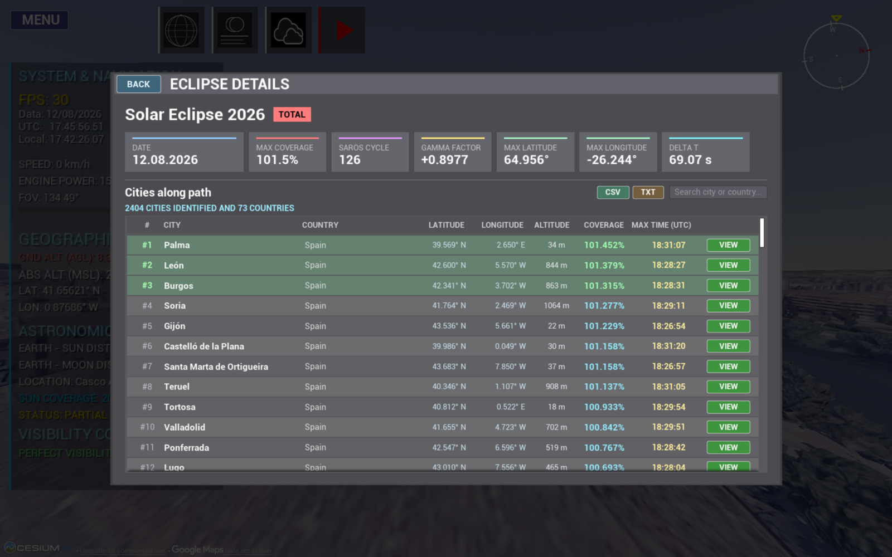
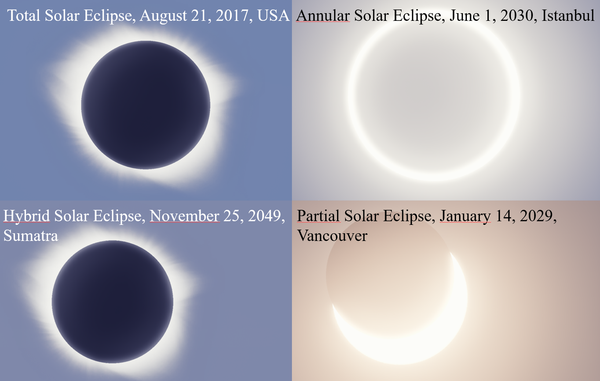
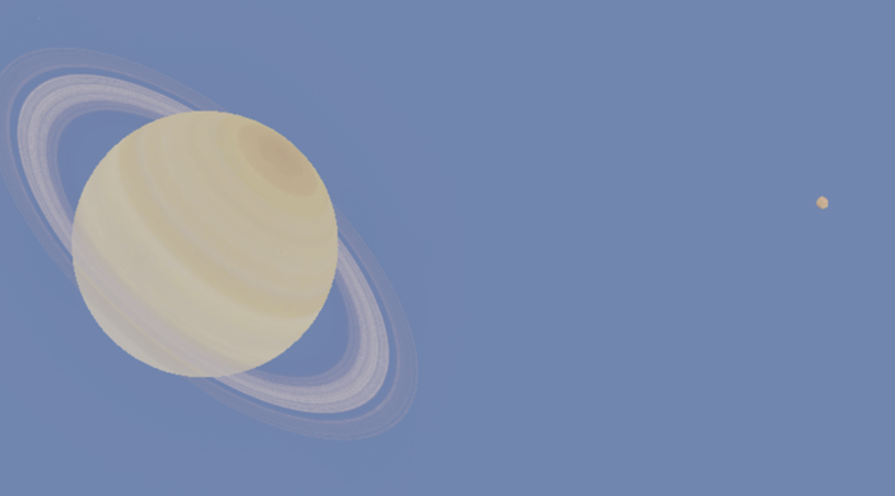
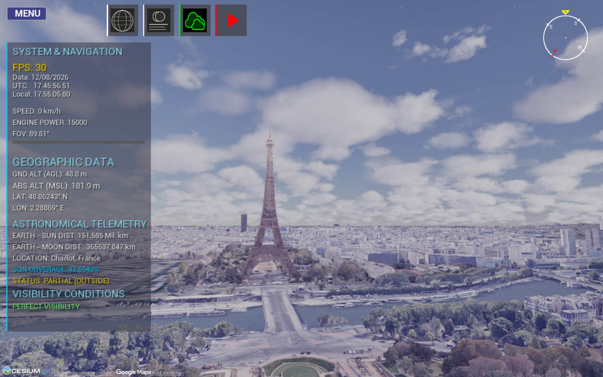
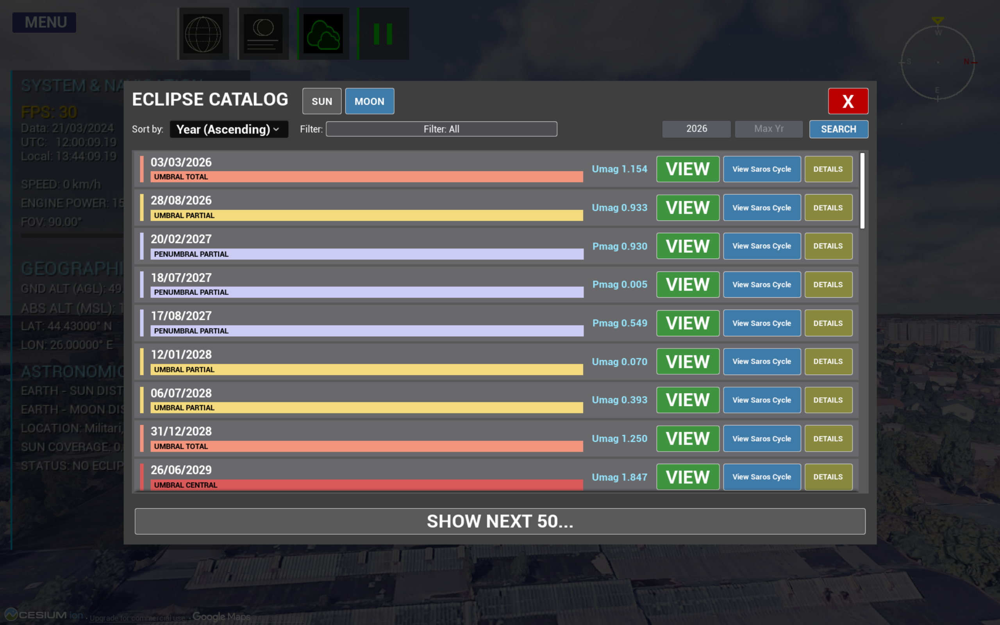
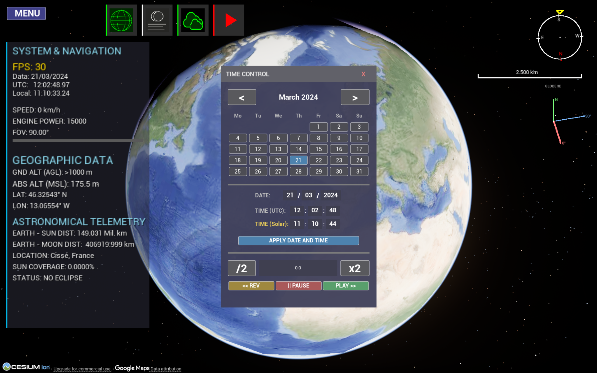
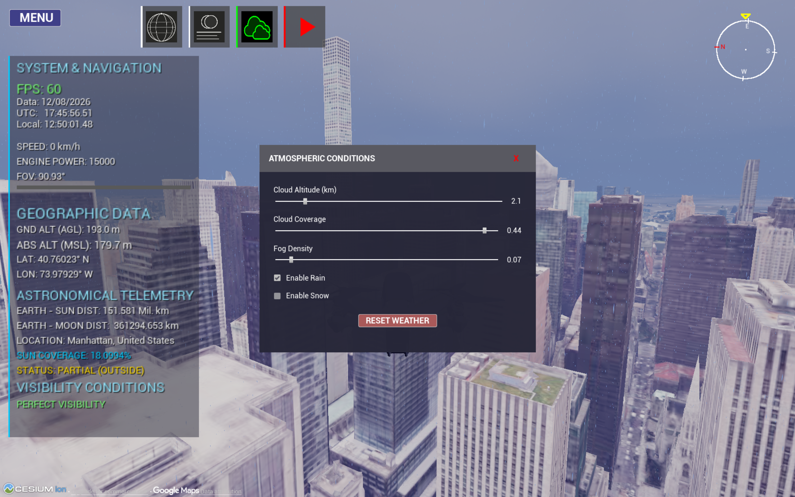

<div align="center">

<!-- Replace with your best screenshot / GIF: the shadow cone over Earth -->


# 🌑 3D Eclipse Simulator

### See the geometry of an eclipse — not just a shaded band on a map.

A real-time **3D eclipse simulator** that renders the **umbra and penumbra as physical cones** sweeping across a geographically accurate Earth.
Built with **Unreal Engine 5**, **Cesium World Terrain** and a **Python / Skyfield** backend driven by **JPL DE441** ephemerides.

[](https://www.unrealengine.com/)
[](#-how-it-works)
[](https://www.python.org/)
[](https://rhodesmill.org/skyfield/)
[](https://cesium.com/)
[](#-getting-started-build-from-source)
[](LICENSE)

**[▶ Demo 1](https://www.youtube.com/watch?v=sYdvDpyHnCw)** · **[▶ Demo 2](https://www.youtube.com/watch?v=clGfikjfNSE)** · **[⬇ Gumroad](https://gabyboncan.gumroad.com/l/txlkbg)** · **[🎮 itch.io](https://dragosboncan.itch.io/3d-eclipse-simulator)**

</div>

<br>

| 🕰️ **30,000 years** | ☀️ **71,264 solar eclipses** | ⏱️ **0.1 - 2 s** vs. reference | ⭐ **5,079 stars** | 🎞️ **~60 FPS** |
|:---:|:---:|:---:|:---:|:---:|
| 13,000 BC → 17,000 AD | Irwin 2021 catalogue | C1–C4 contact times | HYG 4.2, magnitude < 6 | real-time, with Cesium terrain |

---

## 📖 Contents

[Why](#-why-this-project) · [Features](#-features) · [Gallery](#-gallery) · [Demos](#-demo-videos) · [Download](#-download) · [Controls](#-controls--first-run) · [Build from source](#-getting-started-build-from-source) · [Hardware](#-hardware--performance) · [How it works](#-how-it-works) · [How Cesium is used](#-how-cesium-is-used) · [Lunar limb](#-lunar-limb-a-neural-elevation-model) · [Eclipse types](#-eclipse-types) · [Case studies](#-case-studies) · [Validation](#-validation--accuracy) · [Comparison](#-comparison-with-other-tools) · [Limitations](#-limitations) · [FAQ](#-faq) · [Troubleshooting](#-troubleshooting) · [Roadmap](#-roadmap) · [Timeline](#-project-timeline) · [Contributing](#-contributing) · [Credits](#-credits--acknowledgements) · [Cite](#-how-to-cite) · [License](#-license)

---

## 🎯 Why this project?

If you look at the tools available to researchers, educators and eclipse chasers, most of them are limited to **2D visualizations** (maps with shaded bands) or output **tabular data** (contact times, coordinates, durations). What is largely missing is a way to *see* the geometry of an eclipse: the umbra and penumbra as three-dimensional cones sweeping across a real Earth.

3D Eclipse Simulator combines, to the best of my knowledge for the first time in this form:

1. the real-time graphics of **Unreal Engine 5**,
2. geospatial terrain and imagery from **Cesium** (Cesium World Terrain),
3. the astronomical precision of the **JPL DE441** ephemerides.

It started as my Bachelor's thesis, *"Real Shadow Cones Produced During the Central Solar Eclipse (Total Solar Eclipse and Annular Solar Eclipse)"*, at the **Faculty of Automatic Control and Computers, National University of Science and Technology Politehnica Bucharest**, and is now released as open source.

### Who is it for?

| 🎓 Educators, students, planetariums | 📷 Eclipse chasers & photographers |
|---|---|
| A fully immersive 3D alternative to static 2D maps. Simulate an eclipse from **any point on Earth, at any moment in 30 millennia**, and understand *why* it looks the way it does. Designed with future planetarium integration in mind. | Detailed calculations for **every eclipse** in the range, plus shadow geometry and **azimuth / altitude** for each contact — directly useful for positioning and calibrating optical equipment. |

---

## ✨ Features

**Astronomy & geometry**
- 🌍 **All four eclipse types** — total, annular, hybrid and partial — classified purely from geometry, not hard-coded rules.
- 🔺 **True 3D umbra & penumbra cones**, with the Earth modeled as a **WGS84 ellipsoid** (not a sphere), so the equatorial bulge — which measurably shifts where the shadow meets the surface, especially near the poles — is accounted for.
- 🛣️ **Path of totality / annularity rendered as a real 3D band** on Cesium terrain, not a flat 2D overlay.
- ⏱️ **Precise contact times C1–C4** with altitude and azimuth for each, computed by iterative root-finding. Edge cases are handled too, e.g. an extra **"Sunset"** row when the Sun sets before C4.
- 📚 **71,264 solar eclipses** and **72,272 lunar eclipses**  (13,000 BC → 17,000 AD) built on the John Irwin 2021 catalogue, with a searchable / filterable / sortable catalogue browser.
- 🔁 **Saros cycles** — from any catalogue entry, **View Saros Cycle** opens the series of eclipses related to it (a Saros repeats every ~18 years 11 days), so you can follow how the geometry evolves from one eclipse to the next.
- 🪐 **Beyond Earth–Moon**: planets and major moons (Galilean moons, Titan, Triton) tracked with the same DE441 ephemerides.

**Experience**
- 🚁 **Drone camera & free flight** — from orbit to street level in one continuous flight, with terrain streaming in as you go.
- ⭐ **Accurate night sky** — 5,079 naked-eye stars (HYG 4.2), constellation lines & names, and optional mythological constellation artwork.
- 📡 **Live telemetry** — Earth–Sun / Earth–Moon distance, angular size, azimuth, altitude, magnitude, light time, solar elongation, coverage and status ("totality inside"…).
- 🕒 **Time Control panel** — calendar, UTC / solar time, play, pause, rewind, speed multipliers.
- 🔖 **Saved Locations** — bookmarks with title, notes, date/time, GPS coordinates, optical zoom and tracking settings.
- 🎨 **Visual effects & atmosphere** — bloom, star brightness, corona, exposure, clouds, fog, rain and snow, all independent of the astronomical computation.
- 🖍️ **Customizable overlays** — stars, planets, names, constellation lines, 2D ground projection or full 3D cones, with custom umbra / penumbra colors.
- 🌐 **Bilingual** reports and UI: English and Romanian.

---

## 🖼️ Gallery

| **3D Shadow Cone & Umbra View** | **Eclipse details and city visibility** |
|---|---|
|  |  |
| **Eclipse Catalog & Search** | **All types of solar eclipses** |
|  |  |
| **Night Sky in Bucharest** | **Saturn and Titan** |
|  |  |
| **Eiffel Tower from Cesium** | **Lunar Eclipse Catalogue** |
|  |  |
| **Time control menu** | **Customisable weather** |
|  |  |

## 🎬 Demo videos

| | |
|---|---|
| **Demo 1 — Thriller for 3D Eclipse Simulator using Unreal Engine 5** | [](https://www.youtube.com/watch?v=sYdvDpyHnCw) |
| **Demo 2 — 3D Eclipse Simulator Demo** | [](https://www.youtube.com/watch?v=clGfikjfNSE) |

<details>
<summary><b>🎞️ What the demos walk through</b></summary>

| Scenario | Highlights |
|---|---|
| **13,000 BC** — total eclipse | Extreme historical case: catalogue → teleport → drone flight to maximum totality, telemetry, contact table, totality band across Greenland |
| **11 Aug 1999** | Totality over Europe; flight to Bucharest to show *what if it had passed over the city*; free flight at speed; un-eclipsed Sun for contrast (magnitude −26.74) |
| **12 Aug 2026** | Iceland → northern Spain, diamond-ring effect, extra *Sunset* row in the contact table |
| **2 Aug 2027** — Luxor | 6 min 20 s totality, Zaragoza comparison, Nile, custom penumbra color |
| **1 Jun 2030** — annular | Ring of fire over Istanbul, Time Control panel, near-apogee Moon (> 400,000 km) |
| **Year 16,998** | Far-future totality over the Pacific; sunset with partial eclipse on the US west coast |
| **Solar system** | Space → street level over Bucharest, Jupiter's moons, Triton (> 4.6 billion km, 4 h 16 min light time), Mercury |
| **Night sky** | Overlays & Visuals panel, mythological constellations, Moon close-up, daytime stars |
| **Weather & bookmarks** | Cloud / fog / rain / snow, Saved Locations |

</details>

---

## ⬇️ Download

Don't want to build from source? Grab a ready-to-run build:

| 🛒 Gumroad | 🎮 itch.io |
|---|---|
| [**Download on Gumroad**](https://gabyboncan.gumroad.com/l/txlkbg) | [**Download on itch.io**](https://dragosboncan.itch.io/3d-eclipse-simulator) |

---

## 🎮 Controls & first run

Press **F10** at any time to open the in-app **Basic Manual**.

### 🔑 First run: Cesium ion access token (bring your own key)

The global terrain and imagery are streamed live from Cesium ion. The simulator
follows a **bring-your-own-key (BYOK)** model: you use your own free Cesium ion
token, so terrain streaming counts against your own Cesium account and no shared
key is bundled with the app.

1. Go to [ion.cesium.com](https://ion.cesium.com) and create a free account.
2. Open **Access Tokens** in the left menu.
3. Click **Create Token**, or copy the **Default Token**.
4. In the simulator, open **Settings** and paste the key in the **Cesium API Key** field.
5. Click **Apply**.

You only need to enter the token once; the app remembers it for later sessions.
An internet connection is required whenever terrain is streamed.

### 🚁 Flight (drone)

| Key | Action |
|---|---|
| `W` `A` `S` `D` | Movement |
| `Q` / `E` | Up / down |
| `Z` / `X` | Rotate left / right (yaw) |
| Mouse scroll | Optical zoom in / out |
| Right click (hold) | Move the camera freely |

### 🗺️ Global map

| Key | Action |
|---|---|
| `M` | Open / close the top-down global map |
| `W` `S` | Move up / down (latitude) |
| `A` `D` | Move left / right (longitude) |
| `Q` `E` | Rotate around the current point |
| Left click + drag | Drag the globe to explore |
| Left click | Instant teleport to that location |

### ⏱️ Hotkeys & quick buttons

| Key / button | Action |
|---|---|
| `F10` | Open the manual |
| `P` · ▶/⏸ button | Pause / resume simulation time |
| `C` | Halve simulation speed |
| `V` | Double simulation speed |
| `N` · ☁ button | Show / hide clouds |
| 🌐 button | Toggle global map ↔ normal flight (same as `M`) |
| 🌘 button | Open the contact-time table (C1–C4, with sunrise and sunset) for the current location |

### 🌑 Jumping to an eclipse

Open the **Eclipse Catalog**, pick **Sun** or **Moon**, filter or sort, then click **VIEW**. The simulator sets the time and coordinates of the maximum phase automatically.

## 🚀 Getting started (build from source)

### 🧰 Requirements

- Windows 10/11 with a DirectX 12-capable GPU (see [Hardware & performance](#-hardware--performance))
- Unreal Engine 5 (developed with 5.7) and the Cesium for Unreal plugin v2.22.1 (installed from Fab, see step 4).
- **Visual Studio** with the *Game development with C++* workload
- **Python 3.13**
- ~6 GB free disk space for the ephemerides (`de441.bsp` alone is 3.2 GB; the Jupiter, Saturn and Neptune satellite kernels add the rest)
- A free **Cesium ion** access token (the app asks for it on first run)


### 💻 Hardware & performance

| | Minimum | Recommended |
|---|---|---|
| **CPU** | Intel Core i5 or equivalent | Intel Core i9 or equivalent |
| **GPU** | Integrated, 2 GB, DirectX 12 | Dedicated, 8 GB VRAM or more |
| **RAM** | 12 GB | 32 GB |
| **Disk** | ~10.2 GB (4.6 GB installer + 5.6 GB application), SSD | ~12 GB, SSD |
| **Network** | Internet connection (Cesium terrain streaming) | Internet connection |
| **OS** | Windows 10 | Windows 11 |

The packaged application is about 6 GB. Building from source needs about **12 GB** with the development environment, plus ~6 GB for the ephemerides (see [Installation](#-installation)). The minimum configuration is an estimate of what the application needs to run; expect a much lower frame rate than on the recommended one.

The **~60 FPS** figure was measured on a laptop with an **NVIDIA RTX 5070 Ti Laptop GPU (12 GB VRAM)**, **32 GB RAM**, **Intel Core Ultra 9 275HX**, at **2560x1600**, **quality: Epic**, with Cesium terrain streaming. Frame rate depends on the GPU and on network speed for terrain tiles; the astronomical backend never blocks the render loop (see [How it works](#-how-it-works)).


### 📦 Installation

**1️⃣ Clone the repository**

```bash
git clone https://github.com/Dragos112358/Eclipse-Simulator-3D.git
cd Eclipse-Simulator-3D
```

**2️⃣ Add the Encoder runtime**

Open the [**Releases**](https://github.com/Dragos112358/Eclipse-Simulator-3D/releases) page, download
[`Eclipse-Simulator-Encoder-win64.zip`](https://github.com/Dragos112358/Eclipse-Simulator-3D/releases/download/v1.0.0/Eclipse-Simulator-Encoder-win64.zip),
unzip it and copy its contents into the **repository root**.
This creates the `Content/Encoder/_internal` folder and a high-resolution moon texture, which are required for the application to run correctly.

**3️⃣ Download the ephemerides**

```bash
python3 Download_Ephemerides/Downloader.py
```
(On Windows you can also use `py` instead of `python` or `python3`.)

The script downloads:

| File | Content |
|---|---|
| `de441.bsp` | Sun, Moon, Earth and planetary barycenters (**3.2 GB**, downloaded in two parts and merged with `spkmerge`) |
| `jup365.bsp` | Jupiter and the Galilean moons |
| `sat441.bsp` | Saturn and Titan |
| `nep097.bsp` | Neptune and Triton |
| Moon texture | High-quality lunar surface texture |

> ⏳ In total this is roughly **5–6 GB** and can take **up to an hour**, depending on your machine and connection.

**4️⃣ Install the Cesium for Unreal plugin**

The project depends on the **Cesium for Unreal** plugin (tested with
**v2.22.1** on Unreal Engine **5.7**). It is not included in this repository.

1. Open **Fab** (inside the Epic Games Launcher, or at fab.com) and search for
   *Cesium for Unreal*. Click **Add to Library**, then **Install to Engine**
   and choose UE 5.7.
2. Make sure the plugin is installed. Unreal will enable it automatically from the `.uproject`.

Alternatively, download the build matching your engine version from
[Cesium for Unreal releases](https://github.com/CesiumGS/cesium-unreal/releases)
and unzip it into `Plugins/CesiumForUnreal/` inside the project.

A different plugin version may work, but only **v2.22.1** was tested.

**5️⃣ Generate the Visual Studio project files**

Right-click **`Proiect_Eclipsa.uproject`** → **Generate Visual Studio project files**.

**6️⃣ Build & open the project**

Open the generated **`.sln`** file in Visual Studio and build the project.
Then open `Proiect_Eclipsa.uproject` (or launch it from Visual Studio). If Unreal asks
to rebuild modules, accept; the first build can take several minutes. You can
verify the plugin under `Edit → Plugins → Geospatial → Cesium for Unreal`.

### 🐍 Backend server

The Python backend source lives in [`Server/`](Server). `Content/Encoder/` is the folder the backend runs from: it holds the packaged `Server.exe` (built with PyInstaller), the `_internal` runtime from step 2 and the backend's data files. **`Content/Encoder/Server.py` is the same script as `Server/Server.py`.**

```bash
pip install -r Server/requirements.txt
```

The Python backend can run **standalone**, independently of the Unreal project. To do so, run the server **from `Content/Encoder`** (the folder that contains the `_internal` runtime from step 2):

```bash
cd Content/Encoder
python3 Server.py
```
(On Windows you can also use `py` instead of `python` or `python3`.)

### 📂 Repository layout

| Path | Contents |
|---|---|
| `Source/` | Unreal Engine C++ source (frontend, UI, drone camera, rendering) |
| `Content/` | Unreal assets (and `Encoder/_internal` after step 2) |
| `Content/Encoder/` | Working folder of the backend: packaged `Server.exe`, `_internal` runtime, data files |
| `Config/` | Unreal project configuration |
| `Server/` | Python backend (Skyfield, geometry, UDP server) |
| `Download_Ephemerides/` | Script that fetches DE441 and other ephemerides for Jupiter, Saturn, Neptune and the Moon texture |
| `Proiect_Eclipsa.uproject` | Unreal Engine project file |
| `validation/` | Besselian-elements script, comparison data and the validation method (see [Validation](#-validation--accuracy)) |
| **`Content/Encoder/`** | Lunar limb model weights (67 MB, fp16) and `CountryPoints.csv` (city list used by the catalogue **Details** view)|
| `Lunar_AI/` | Training, evaluation and export code for the lunar limb elevation model (see [Lunar limb](#-lunar-limb-a-neural-elevation-model)) |
| `docs/` | Images and third-party licences (`docs/THIRD_PARTY.md`) |
| `LICENSE`, `NOTICE` | Apache 2.0 licence and notices |
| `CONTRIBUTING.md`, `CITATION.cff` | How to contribute; citation metadata |

---

## 🧠 How it works

### Two-tier architecture

```
┌──────────────────────────────┐   :5000  UDP · 80 B request / frame      ┌─────────────────────────────────┐
│  Unreal Engine 5  (frontend) │ ───────────────────────────────────────▶ │  Python  (computational backend) │
│  Rendering · UI · Cesium     │                                          │  Skyfield · DE441 · GeoPy        │
│  Drone camera · VFX · HUD    │ ◀─────────────────────────────────────── │  Multithreaded                   │
│                              │   :5001  UDP · 4,056 B response / frame  │                                  │
│                              │                                          │                                  │
│  Eclipse Catalog → Details   │ ───────────────────────────────────────▶ │  City visibility solver          │
│                              │   :5002  UDP · 8 B request (JD TT)       │  (vectorized, ternary search)    │
│                              │ ◀─────────────────────────────────────── │                                  │
└──────────────────────────────┘   :5002  UDP · chunks of 500 cities      └─────────────────────────────────┘
                                          (12 B header + 20 B / city)
```


| Port | Direction | Purpose |
|---|---|---|
| `5000` | Unreal → Python | Per-frame request: date/time, observer position, language |
| `5001` | Python → Unreal | Per-frame response: body positions, shadow path, report text |
| `5002` | Unreal ↔ Python | On-demand city list for the catalogue **Details** view; the reply goes back to the sender in chunks of 500 cities |

**Why UDP?** The backend streams fresh celestial positions every frame. If a packet is dropped, the next one — a few milliseconds later — already supersedes it, so TCP's retransmission and ordering would only add latency. UDP also keeps the door open for running the backend remotely (e.g. offloading heavy computations to a server) without a rewrite.

**Why multithreaded?** The *main thread* answers every frame: it computes body positions and the live HUD values and must never block. A *secondary thread* runs the heavy work: contact-time root-finding, the global shadow path and band width, the lunar-limb correction, the report table and GeoPy lookups. It is triggered only when the location, date or language changes (at most once per second) and is deferred while the simulation is fast-forwarding, so the render loop never stutters.


### Computation pipeline

| # | Stage | What happens |
|---|---|---|
| 1 | **Time synchronization** | `finals2000A.all` provides Earth Orientation Parameters for ΔT and Earth's rotational irregularities, shared by the Python backend and the C++ frontend. |
| 2 | **Ephemerides** | JPL **DE441** is loaded through Skyfield; objects are instantiated for the Sun, Moon, Earth and the barycenters of the other planets. |
| 3 | **Shadow vector** | The cone axis `z_dir` is derived from the apparent Sun/Moon coordinates after transforming them into **ITRS** (Earth-fixed), so the shadow can be projected on the *rotating* Earth. |
| 4 | **Intersection modeling** | Given the axis and the umbra/penumbra angular radii, a **quadratic equation** gives the entry and exit points of the cone on the **WGS84 ellipsoid**. |
| 5 | **Contact times** | C1–C4 are found by iterative root-finding on the secondary thread. |
| 6 | **Path & band width** | The cone axis is intersected with the WGS84 ellipsoid at 100 time steps; the band width at each point comes from projecting the umbra cross-section onto the tangent plane, using the shadow's ground velocity and the Sun's altitude. |
| 7 | **Lunar-limb correction** | For each contact: libration (l, b) and axis angle → selenographic point on the limb → neural elevation → corrected Moon radius → contact time re-solved by bisection. Also yields the corrected maximum (MAXL) and totality duration. |
| 8 | **City visibility** | For the catalogue **Details** view: all cities in `CountryPoints.csv` are evaluated in a vectorized pass over a coarse time grid, then refined to sub-second with a ternary search (magnitude, offset, UTC time, total/annular flag). |
| 9 | **Reports** | Contact table with both geometric (C1–C4) and limb-corrected (C1L–C4L, MAXL) rows, plus sunrise/sunset, Sun's constellation and visible planets. |

### Fixed-layout binary packets

| Direction | `struct` format | Size | Content |
|---|---|---|---|
| **Python → Unreal** | `357d1200s` | **4,056 B** | 8 doubles: Sun & Moon XYZ (ITRS, km), live magnitude, GAST (64 B) · 7 planets (168 B) · 6 moons (144 B) · **path block** (2,408 B): point count + 100 lon/lat pairs + 100 band widths · live shadow lat/lon + ΔT (24 B) · Sun/Moon center-to-center vectors (48 B) · 1,000-byte UTF-8 report text (location names, contact times…) |
| **Unreal → Python** | `10d` | **80 B** | Year, month, day, hour, minute, precise seconds · observer latitude, longitude, altitude (WGS84) · language flag (`0` = Romanian, `1` = English) |

A fixed binary layout (instead of JSON) lets Unreal read every field directly by byte offset: no allocation or parsing, sixty times a second. The path-width array is what lets Unreal render the totality band as a **curved 3D mesh** instead of a fixed-width strip.

### Time scale & calendars

- **ΔT.** Outside 1900–2100 the server applies the **Espenak & Meeus** polynomials (identically in Python and C++).
  Inside 1900–2100 it uses Skyfield's built-in ΔT tables (IERS observations plus short-term predictions);
  past the end of the tabulated data, Skyfield extrapolates from the last values. This is why the 2038
  validation case differs by ~21 s from Jubier (see [`validation/`](validation/)).
- **Calendar reconciliation.** Skyfield works internally in the *proleptic Gregorian* calendar, while the
  Irwin catalogue reports ancient dates in the *Julian* calendar, the one actually in use at the time.
  The two drift apart by a growing number of days the further back you go. Left unhandled, an ancient
  eclipse is silently mis-dated by days, which is enough to put the whole computed path in the wrong
  place relative to the historical record. The server therefore builds the time scale explicitly:
  - dates up to 1582 are converted to a Julian Date with the **Julian** calendar formula, later dates
    with the Gregorian one;
  - outside 1900–2100 the **Espenak & Meeus** ΔT polynomial is applied directly (UT → TT), instead of
    letting Skyfield extrapolate its own model;
  - the same formula is used in reverse when displaying contact times (TT → UT), so the two
    conversions cancel exactly and the shown UTC matches the catalogue date;
  - the search window for the eclipse maximum widens with distance from the present, to absorb the
    larger ΔT uncertainty of ancient dates.

  The 13,000 BC case study is the stress test for this logic.

---

## 🌍 How Cesium is used

- **Terrain & imagery streaming** from Cesium ion (Cesium World Terrain) through Cesium for Unreal (3D Tiles),
- **Georeferencing**: the shadow path computed on the WGS84 ellipsoid in Python is
  placed on the Cesium globe, so the band of totality is drawn directly on terrain.
- **Atmosphere and weather effects** (clouds, fog, rain, snow) rendered over Cesium terrain.
- **Bring-your-own-key** model: each user streams with their own Cesium ion token.
- **Data attribution.** Cesium World Terrain and the imagery layers come from third-party data providers whose credits must be shown.  The providers are listed in [`docs/THIRD_PARTY.md`](docs/THIRD_PARTY.md).

---

### 🌙 Lunar limb: a neural elevation model

The apparent edge of the Moon is not a perfect circle: mountains and craters along the limb shift
the contact times C1–C4 and produce the Baily's beads seen at totality. To model this, I trained a
**neural network that maps selenographic coordinates (longitude, latitude) to surface elevation**,
fitted on the **NASA LRO / LOLA global lunar elevation model** (LDEM, 118 m/pixel,
March 2014 release, distributed by the USGS Astrogeology Science Center), in Simple
Cylindrical projection with elevations relative to the 1,737.4 km lunar reference sphere.

**Why a neural model instead of the raw DEM?** The full-resolution DEM is around 8 GB. The
network compresses the region that matters into a **67 MB** model that can be queried in
real time, at any point, with no tiling or loading.

**Model and code in this repository.** The trained weights (67 MB, fp16) are in `Content/Encoder/lunar_altitude_contact_bands_fp16_finetuned.pt`. They are loaded once, when the backend starts, by `load()` in `Server.py` (`torch.load`, CPU), and the network is converted to fp32 for inference. The training script is in `Lunar_AI`; the LDEM source file is available from the USGS link in [`docs/THIRD_PARTY.md`](docs/THIRD_PARTY.md).


**Architecture**

| Component | Choice |
|---|---|
| Encoding | Multi-resolution **hash grid**, 20 levels × 2 features, table size 2²¹, finest resolution 46,080 cells in latitude (~118 m on the lunar surface) |
| Decoder | MLP, 3 hidden layers × 256, **GELU** activations |
| Storage | fp16 embeddings for deployment, fp32 for training |

The finest hash-grid level (46,080 cells in latitude) matches the native resolution of
the DEM (256 pixels per degree), so no detail present in the source data is discarded
by the encoding grid.

**Design note: hash grid instead of SIREN.**
The first design iteration used a SIREN (sinusoidal-activation MLP) to represent
lunar elevation. It reached a validation RMSE of about 42 m against the DEM,
which was too coarse for limb-profile work, where contact-time corrections depend
on elevation differences of tens of metres. I therefore switched to a
multi-resolution hash-grid encoding + small MLP: the high-resolution levels capture
fine local detail (craters, ridges) while the MLP stays small and fast to query.
The final model reaches a validation RMSE of 12.57 m, roughly 3.3× lower, at the
cost of a larger deployed size (67 MB in fp16) than a purely sinusoidal network
would need.

**Training domain.** Contact points during an eclipse lie near the lunar limb, i.e. around
**±90° selenographic longitude**. Only two longitude bands of ±10° around those meridians
(≈ 11.1 % of the surface) are modeled, which concentrates the whole parameter budget where the
limb profile actually matters.

**Training details**
- **Coarse-to-fine schedule** — hash-grid levels are activated progressively, which stabilizes convergence.
- **Curvature-weighted loss** — peaks and ridges contribute up to 5× more than flat terrain.
- **Curvature-biased sampling** — up to 60 % of each batch is drawn from high-curvature regions.
- **Gradient (slope) loss** — predicted slopes are compared with the DEM's real slopes via finite
  differences, with metric scale correction and a cos(lat) correction for longitude.
- **Training:** Adam with cosine annealing, mixed precision (AMP), 2,000 epochs × 2 M samples.

**Result**

| Metric | Value |
|---|:---:|
| Validation RMSE vs. lunar surface DEM | **12.57 m** |

- **Where it shows up.** The correction is applied to every contact (C1–C4 → C1L–C4L), to the moment of maximum (MAXL) and to the totality duration, which the report shows as **Lunar Limb Duration**.
- For scale, the Moon's radius is 1,737.4 km, so the error is about 0.0007 % of the radius, far below
what is visible in the limb profile at the angular resolution of the simulation.

## 🌓 Eclipse types

The catalogue browser has a **☀️ Sun / 🌙 Moon** switch, so both solar and lunar eclipses can be searched, filtered, sorted by year and opened in the simulator.

### ☀️ Solar eclipses

| Type | Geometry | Example in the thesis |
|---|---|---|
| **Total** | The Moon's umbra reaches the Earth's surface and completely blocks the Sun | 21 Aug 2017, USA |
| **Annular** | Moon near apogee — the umbra falls short of the surface; a "ring of fire" remains | 1 Jun 2030, Istanbul |
| **Hybrid** | Because of Earth's curvature, the eclipse is total along part of its path and annular along another (~11 per century on average) | 25 Nov 2049, Sumatra |
| **Partial** | Only the penumbra sweeps over the observer | 14 Jan 2029, Vancouver |

### 🌙 Lunar eclipses

Lunar eclipses are catalogued in five classes, each with a magnitude shown in the browser (**Pmag** = penumbral magnitude, **Umag** = umbral magnitude):

| Type | Geometry | Magnitude shown |
|---|---|---|
| **Penumbral Partial** | Only part of the Moon enters Earth's penumbra; the umbra is never touched | Pmag |
| **Penumbral Total** | The whole Moon lies inside the penumbra, but still never enters the umbra | Pmag |
| **Umbral Partial** | Part of the Moon enters Earth's umbra | Umag |
| **Umbral Total** | The whole Moon is inside the umbra | Umag |
| **Umbral Central** | A total umbral eclipse in which the Moon passes through the central part of the umbra, close to the shadow axis | Umag |

Every entry has **View** (jump to the event in 3D), **View Saros Cycle** and **Details** buttons. In **Details**, you can see all the cities where you can see that eclipse. The list can be exported as CSV or TXT. For solar eclipses, those cities are sorted by **eclipse magnitude**.


---

## 🧪 Case studies

| Eclipse | Location | Coordinates | Notes |
|---|---|---|---|
| **11 Jul 2010** | Puerto Natales, Chile | 49.049° S, 74.516° W | Totality path, ground shadow projection |
| **12 Aug 2026** | Iceland → northern Spain | 41.649° N, 0.889° W, Zaragoza | Validated against Jubier (≤ 1.5 s); shadow cone viewed in 3D from 30 km altitude (18:33:49 UTC) |
| **2 Aug 2027** | Luxor, Egypt | 25.635° N, 32.594° E | **6 min 20 s**, which is a very long totality; validated against Jubier (≤ 2 s) |
| **1 May 2079** | Queens, USA | 40.759° N, 73.944° W | 10:09 UTC — far-future stability test |
| **10 Oct 13,000 BC** | Canada | 58.262° N, 136.364° W | 18:55 UTC — lower edge of the range; calendar-reconciliation stress test |
| **25 Jul 16,995 AD** | South Hamilton, Australia | 32.934° S, 151.736° E | 14:30:53 UTC — upper edge of the range |

The same pipeline (DE441 propagation, cone–ellipsoid intersection, ΔT as described above) is used across the **entire** 30-millennium range; only the ΔT source changes with the era.

---

## ✅ Validation & accuracy

### Method

Contact times (C1–C4) were compared with **Xavier Jubier's** interactive eclipse maps, the community's reference for high-accuracy 2D eclipse computation, at the same observer coordinates for each eclipse.

- **Reference data.** Jubier's published contact times for the **12 August 2026** and **2 August 2027** eclipses, read on **10 March 2026** from his [2026](http://xjubier.free.fr/en/site_pages/solar_eclipses/TSE_2026_GoogleMapFull.html) and [2027](http://xjubier.free.fr/en/site_pages/solar_eclipses/TSE_2027_GoogleMapFull.html) interactive maps, using his ΔT of **2026: 69.1 s / 2027: 69.3 s**.
- **Compared quantity.** The geometric contact times C1–C4 in UTC, to the second, with the same ΔT convention on both sides. The limb-corrected C1L–C4L are reported separately.
- **Reproducibility.** The comparison script, the inputs and the per-contact tables are in [`validation/`](validation/).

| Eclipse | Max. difference on C1–C4 |
|---|:---:|
| Total — **12 August 2026** | **≤ 1.5 s** |
| Total — **2 August 2027** (Luxor) | **≤ 2 s** |

**What 0.1–2 s means.** It is the largest absolute difference between this project's contact times and Jubier's published times, at the locations compared, for eclipses between **1990 and 2040**. Jubier's data cover only that interval, so **outside 1990–2040 there is no independent reference**: for earlier and later eclipses accuracy is supported by consistency checks and the Irwin catalogue, not by a measured error (see [Limitations](#-limitations)).

**Catalogue cross-check.** A standalone Besselian-elements script run over the same 71,264-event catalogue found **719 eclipses** whose umbra/antumbra touched Romania in 30,000 years (plus ~13,000 partial-only), and independently reproduced the documented track of the **11 Aug 1999** eclipse — two different geometric formulations converging on the same result.

---

## 🆚 Comparison with other tools

| Metric | Stellarium | Celestia | SpaceEngine | TPE | Jubier | **This project** |
|---|---|---|---|---|---|---|
| **Temporal accuracy** | 8 min offset for the 2017 US total eclipse | Not designed for eclipse timing | Not designed for eclipse timing | Good | Reference | **0.1–2 s vs. Jubier (1990–2040)** |
| **Real geographic data** | ❌ | ❌ | ❌ | ✅ | ✅ | ✅ |
| **Umbra & penumbra cones rendered** | ❌ | ❌ | ❌ | ❌ | ❌ | ✅ |
| **Free flight** | ❌ | ✅ | ✅ | ❌ | ❌ | ✅ |
| **Time range** | 12,000 yr (acceptable accuracy) | 10,000 yr (acceptable accuracy) | Unlimited | 2007–2026 (19 yr, free plan) | 1990–2040 | **13,000 BC – 17,000 AD** |
| **Rendering mode** | Semi-2D | 3D | 3D | 2D | 2D | **3D** |

TPE = The Photographer's Ephemeris. Comparisons are based on my own testing.

---

## ⚠️ Limitations

Documented, quantifiable limitations — not open questions:

- **ΔT extrapolation.** The Espenak & Meeus model is an empirical fit to the past few millennia. Near 13,000 BC or 17,000 AD it is an extrapolation, and the real uncertainty in Earth's rotation is measured in **hours**. Results there are *geometrically consistent*, but not validated to the sub-second precision of the 2026/2027 cases.
- **Validation range.** Independent validation against Jubier covers 1990–2040 only; see [Validation](#-validation--accuracy).
- **Ephemeris range.** DE441 comfortably covers the whole span, but its own integration uncertainty grows modestly toward both ends.
- **Limb model coverage.** The elevation model covers only two ±10° longitude bands around ±90° selenographic longitude; a contact that falls outside them (extreme libration) is outside the trained domain.
- **Lunar eclipses.** The catalogue, 3D view and city visibility are supported, but the city list uses one global umbral magnitude per eclipse and a "Moon above the horizon" test; there are no per-city lunar contact times.
- **Date range.** The server ignores requests outside 13,000 BC – 17,000 AD.
- **Network.** The astronomical backend (Skyfield + DE441) runs fully offline once the
  ephemerides are downloaded, and can be used standalone. The full 3D application,
  however, needs an internet connection: Cesium terrain and imagery tiles are streamed
  live from Cesium ion, and location names are resolved through Nominatim (with a
  GPS-coordinate fallback). Without a connection the astronomical data and contact
  times keep working, but the Cesium World Terrain does not load.
  - **Geocoding (Nominatim).** Location names are looked up on the public OpenStreetMap Nominatim service, whose usage policy asks for at most one request per second, an identifying User-Agent and caching of results.
- **Limb model vs. ground truth.** The 12.57 m RMSE is measured against the gridded
  LOLA DEM (118 m/pixel), not against the true lunar surface. Features smaller than the
  DEM resolution, and any interpolated gaps in the DEM, are not represented.
- **Near-future ΔT.** After the end of the IERS data, ΔT is extrapolated; for 2038 this alone shifts contacts by ~21 s relative to Jubier.
- **Limb-corrected contacts.** C1L–C4L have not been compared with an independent reference.
- **Totality duration.** Totality is systematically 1.4–1.9 s shorter than Jubier's; the probable cause is the lunar radius used for the contacts (without the lunar limb) (see `validation/`).

---

## ❓ FAQ

<details>
<summary><b>How do you find which eclipses occur at a specific location?</b></summary>

For each catalogue event, the Besselian elements (x, y, d, μ and cone radii L₁/L₂) are evaluated on a fine time grid around maximum eclipse, for the observer's coordinates (converted to geocentric ρ sin φ′ / ρ cos φ′). If the distance to the shadow axis *m* drops below |L₂| the eclipse is total/annular there; below L₁, at least partial.
</details>

<details>
<summary><b>Skyfield does the astronomy and Unreal does the rendering — what's the actual contribution?</b></summary>

Skyfield only provides raw ephemeris positions; it does not compute shadow cones, contact times or eclipse classification. Everything on top is this project: the shadow vector, the cone–ellipsoid intersection, the C1–C4 root-finding pipeline, ΔT and calendar reconciliation, the real-time bridge into Unreal, and the multithreaded design that keeps it from blocking the render loop.
</details>

<details>
<summary><b>Why UDP if both processes run on the same machine? Wouldn't shared memory or a single process be simpler?</b></summary>

Locally the overhead is negligible either way, so the choice is about design headroom:

- **Remote-ready.** The backend can later run on a server (e.g. offloading heavy contact-time and city-visibility computations) while the frontend stays lightweight on a client, with no rewrite.
- **Loss is harmless.** The backend streams fresh positions every frame. A dropped packet is superseded by the next one a few milliseconds later, so TCP's handshaking, retransmission and ordering would only add latency by redelivering stale data.
- **Process isolation.** The Python backend can run standalone (see *Backend server*), be restarted independently, and be tested without launching Unreal.
</details>

<details>
<summary><b>How do you validate ancient eclipses with no independent reference?</b></summary>

By consistency: the same model produces smoothly varying, plausible results across the whole range without discontinuities, and event classification and rough timing are cross-checked against the Irwin catalogue, the closest thing to ground truth for that era.
</details>

<details>
<summary><b>Can it simulate lunar eclipses?</b></summary>

Yes — the geometry is largely symmetric (the Moon passes through Earth's shadow, and the intersection surface becomes the Moon instead of the WGS84 ellipsoid).
</details>

---

## 🛠️ Troubleshooting

<details>
<summary><b>The globe is empty / terrain never loads</b></summary>

Terrain is streamed from Cesium ion. Check that you have an internet connection and
that a valid token is entered in **Settings → Cesium API Key**. Eclipse data and
contact times do not depend on this and keep working without it.
</details>

<details>
<summary><b>The simulator shows no data / the sky and eclipse info never update</b></summary>

Unreal and the Python backend talk over **UDP on localhost**:

| Direction | Port | Protocol |
|---|---|---|
| Unreal → Python (per-frame request) | `5000` | UDP |
| Python → Unreal (per-frame response) | `5001` | UDP |
| Unreal ↔ Python (city list for **Details**) | `5002` | UDP |

Make sure only **one** Python server is running and that ports 5000–5002 are free
(`netstat -ano | findstr "5000 5001 5002"`). Kill any leftover `Server` / `python` process and restart.
Only if you use a security suite that filters loopback traffic, allow UDP 5000–5002 for `127.0.0.1`.
</details>

<details>
<summary><b>The app or server fails to start: <code>_internal</code> folder missing</b></summary>

`Content/Encoder/_internal` is not part of the git repository. It comes from the release archive
`Eclipse-Simulator-Encoder-win64.zip` (see **step 2** of the installation). Download it from
[Releases](https://github.com/Dragos112358/Eclipse-Simulator-3D/releases), unzip it **into the repository
root**, and make sure the path `Content/Encoder/_internal` exists. Without it the encoder/video features and
the standalone `Server.py` cannot run.
</details>

<details>
<summary><b>Ephemeris errors or very slow first start</b></summary>

Re-run `python3 Download_Ephemerides/Downloader.py` (or `python Download_Ephemerides/Downloader.py`) and check that `de441.bsp`, `jup365.bsp`, `sat441.bsp`
and `nep097.bsp` are all present and that you have enough free disk space. An interrupted download of
`de441.bsp` (two parts + merge) is the most common cause.
</details>

## 🗺️ Roadmap

- [x] All four solar eclipse types, 3D cones on WGS84, contact times C1–C4
- [X] Accurate models (Skyfield from Python) for Moon and Sun to produce eclipses
- [x] Integration with Cesium for Unreal
- [x] Extension to Solar System (all planets and 7 big natural satellites including the Moon)
- [x] 30,000-year catalogue browser
- [x] Solar-system expansion (planets & moons)
- [x] Lunar eclipse support
- [x] Details about every eclipse 
- [x] Lunar limb (topographic profile) modeling
- [x] Shadow cones for solar and lunar eclipses
- [x] Bookmark system to save different places and times
- [ ] Optimal route planning for eclipse chasers
- [ ] VR planetarium mode (OpenXR)
- [ ] Planetarium integration
- [ ] Tutorial: connecting Cesium for Unreal to a Python astronomy backend
- [ ] Education mode: redesigned interface and guided lessons for classrooms and planetariums
- [ ] Weather along the path of totality (ERA5-based climatology driving Cesium clouds)

---

## 🕰️ Project timeline

> Calendar dates below; development was part-time and not continuous (exams, thesis
> work and breaks), so the span is longer than the actual working time.

| When | Milestone |
|---|---|
| **9 Jan 2026** | Project started — first Skyfield ↔ Unreal UDP prototype |
| **21 Feb 2026** | Cesium integration, 3D totality band |
| **10 Mar 2026** | 3D umbra/penumbra cones and WGS84 intersection |
| **17 Mar 2026** | Eclipse catalogue (71,264 events) and browser UI |
| **April 2026** | Solar-system expansion, sky overlays, weather effects |
| **May 2026** | Presented at a student scientific session — **honorable mention** |
| **Jul 2026** | Bachelor's thesis completed |
| **12 Aug 2026** | Total eclipse over Iceland & Spain — validated using 3D Eclipse Simulator |
| **11 Oct 2026** | Open-source release |
| **2 Aug 2027** | Next total eclipse — Luxor, 6 min 20 s 🌑 |

---

## 🤝 Contributing

Bug reports, ideas and pull requests are welcome. Please read [`CONTRIBUTING.md`](CONTRIBUTING.md) first: it explains how to report a bug (include your Unreal Engine and Cesium for Unreal versions, the eclipse and date you were viewing, and the backend console output) and how to propose changes. Questions and feature ideas can go in GitHub Issues.

## 🙏 Credits & acknowledgements

### 👤 Development

| Role | Name |
|---|---|
| **Developer** | Boncan Dragoș-Eduard-Gabriel — [@Dragos112358](https://github.com/Dragos112358) |
| **Thesis supervisor** | Assoc. Prof. Victor-Iosif Asavei, PhD |
| **Thesis supervisor** | Lect. Florin-Cătălin Tudose, PhD |
| **Scientific coordinator** | Astronomer Cătălin Beldea |

### 🛠️ Software & astronomy engine

| | Used for |
|---|---|
| 🎮 [**Unreal Engine 5**](https://www.unrealengine.com/) — Epic Games | Real-time rendering engine |
| 🗺️ [**Cesium for Unreal**](https://cesium.com/) | Cesium World Terrain 3D globe and terrain |
| 🌐 [**Skyfield**](https://rhodesmill.org/skyfield/) — Brandon Rhodes | Astronomical calculations |
| 🪐 [**NASA JPL DE441**](https://naif.jpl.nasa.gov/) and SPICE kernels — NASA NAIF | Planetary and lunar ephemerides |
| 🛰️ **JPL satellite kernels** `jup365.bsp`, `sat441.bsp`, `nep097.bsp` — NASA NAIF | Jupiter, Saturn and Neptune moon systems |
| 📜 [**John Irwin**](http://www.jir1667.plus.com/eclipse/eclipsecats3/index.html) | *Thirty Millennium Catalog of Solar and Lunar Eclipses* (13,000 BC – 17,000 AD), 3rd ed., 2021 |
| 🌍 [**IERS**](https://www.iers.org/IERS/EN/DataProducts/EarthOrientationData/eop.html) | `finals2000A.all` Earth rotation data |
| 🧮 **Espenak & Meeus** | ΔT polynomials |
| ⭐ [**HYG Database**](https://www.astronexus.com/hyg) — David Nash / Astronexus (CC BY-SA 4.0) | Background star catalogue (HYG 4.2) |
| 🎞️ [**FFmpeg**](http://ffmpeg.org) (GPLv3.0) | Video processing. This software uses code of FFmpeg; source code is available on the official website. |
| 📍 [**Nominatim**](https://www.openstreetmap.org/copyright) — data © OpenStreetMap contributors | Geocoding service |
| 🏙️ [**GeoNames**](https://www.geonames.org/) (CC BY 4.0) | City and country data (`cities5000`, `countryInfo`) used to generate `CountryPoints.csv` |
| 🐍 [**Python**](https://www.python.org/) — © Python Software Foundation | Backend server |
| 🔢 [**NumPy**](https://numpy.org/) (BSD License) | Scientific computing |
| 📌 [**GeoPy**](https://geopy.readthedocs.io/) (MIT License) | Geocoding client |
| 🌙 [**NASA LRO / LOLA**](https://astrogeology.usgs.gov/search/map/moon_lro_lola_dem_118m) LDEM 118 m — via USGS Astrogeology Science Center | Lunar elevation model used to train the limb model |

### 🎨 Visual content (textures & 3D models)

| Asset | Source & license |
|---|---|
| Earth 2D texture | [NASA Scientific Visualization Studio](https://svs.gsfc.nasa.gov/2915) (public domain) |
| Moon texture | [NASA Scientific Visualization Studio](https://svs.gsfc.nasa.gov/4720/) (public domain) |
| Total solar eclipse photo | [NASA Science](https://science.nasa.gov/solar-system/skywatching/april-8-total-solar-eclipse-through-the-eyes-of-nasa/) (public domain) |
| Planetary textures | [SolarSystemScope.com](https://www.solarsystemscope.com/textures/) (CC BY 4.0) |
| Europa texture | [USGS Astrogeology Science Center](https://astrogeology.usgs.gov/search/map/europa_voyager_galileo_ssi_global_mosaic_500m) (public domain) |
| Io texture | [USGS Astrogeology Science Center](https://astrogeology.usgs.gov/search/map/io_galileo_ssi_voyager_color_merged_global_mosaic_1km) (public domain) |
| Ganymede texture | [NASA Science 3D Resources](https://science.nasa.gov/3d-resources/jupiter-ganymede/) (public domain) |
| Callisto texture | By Askaniy via [Wikimedia Commons](https://commons.wikimedia.org/wiki/File:Callisto_map_by_Askaniy.png) (CC BY-SA) |
| Triton texture | By Askaniy via [DeviantArt](https://www.deviantart.com/askaniy/art/Triton-Texture-Map-14K-761940736) (CC BY-SA) |
| Titan atmosphere texture | Based on original radar work by FarGetaNik ([Celestia Motherlode](http://www.celestiamotherlode.net/addon/addon_1675.html)), processed under CC BY-SA |
| 3D drone model | ["DJI FPV by SDC"](https://sketchfab.com/3d-models/dji-fpv-by-sdc-high-performance-drone-d471ea8c6235457b8e131842e2cf3783) by SDC PERFORMANCE (Lambo_SC04), licensed under [CC BY 4.0](https://creativecommons.org/licenses/by/4.0/). Modified: changed its original color. |
| Constellation illustrations | [Western skycultures from Stellarium](https://github.com/Stellarium/stellarium-skycultures/tree/master/western/illustrations) (GPL) |

### 🔬 Research & inspiration

- ✅ **Xavier Jubier** — eclipse geometry and concepts are inspired by his work; his interactive eclipse maps for [2026](http://xjubier.free.fr/en/site_pages/solar_eclipses/TSE_2026_GoogleMapFull.html) and [2027](http://xjubier.free.fr/en/site_pages/solar_eclipses/TSE_2027_GoogleMapFull.html) were used as the validation reference.
- 🔭 Benchmarked against: Stellarium, Celestia, SpaceEngine, The Photographer's Ephemeris.

### ⚖️ Legal notes

- This software requires an active internet connection to stream Cesium terrain and
  imagery (and to download the ephemeris data on first setup).
- 3D Eclipse Simulator uses the Unreal® Engine. Unreal® is a trademark or registered trademark of Epic Games, Inc. in the United States of America and elsewhere. Unreal® Engine, Copyright 1998 – 2026, Epic Games, Inc. All rights reserved.
- All textures and 3D models are used in accordance with their respective licenses (see [`docs/THIRD_PARTY.md`](docs/THIRD_PARTY.md)). All rights to astronomical data belong to the mentioned sources.
---

## 📑 How to cite

If you use this project in academic work, please cite it (GitHub's **Cite this repository** button uses [`CITATION.cff`](CITATION.cff)):

```bibtex
@software{boncan2026eclipse_simulator,
  author  = {Boncan Dragoș-Eduard-Gabriel},
  title   = {3D Eclipse Simulator},
  year    = {2026},
  version = {1.0.0},
  url     = {https://github.com/Dragos112358/Eclipse-Simulator-3D},
  license = {Apache-2.0}
}
```

---

## 📄 License

The source code of 3D Eclipse Simulator is released under the **Apache License 2.0**. See [`LICENSE`](LICENSE) and [`NOTICE`](NOTICE) for details.
Copyright © 2026 Boncan Dragoș-Eduard-Gabriel.
Third-party software, data and assets (Unreal Engine, Cesium, Irwin catalogue, HYG, JPL ephemerides, textures, 3D models, FFmpeg, Stellarium illustrations…) are **not** covered by this license and remain under their own licenses and terms — see [Credits](#-credits--acknowledgements) and [`docs/THIRD_PARTY.md`](docs/THIRD_PARTY.md).

---

<div align="center">

⭐ If you like this project, please **star the repo** and share it with fellow eclipse chasers! ⭐

**[⬇ Gumroad](https://gabyboncan.gumroad.com/l/txlkbg)** · **[🎮 itch.io](https://dragosboncan.itch.io/3d-eclipse-simulator)** · **[▶ YouTube](https://www.youtube.com/watch?v=sYdvDpyHnCw)**

</div>