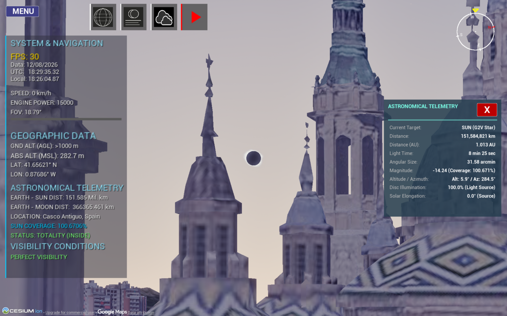
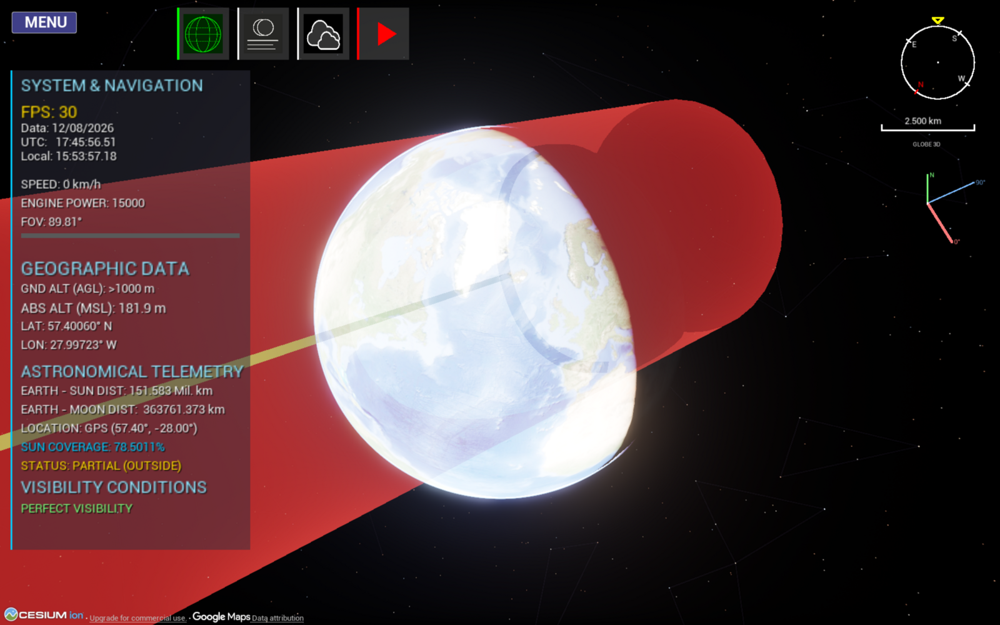
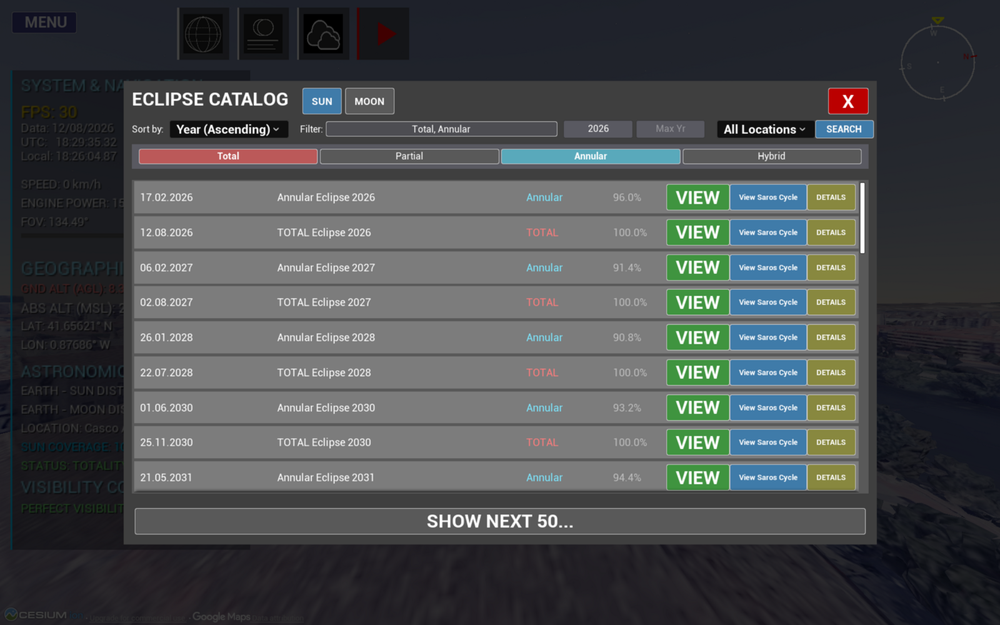
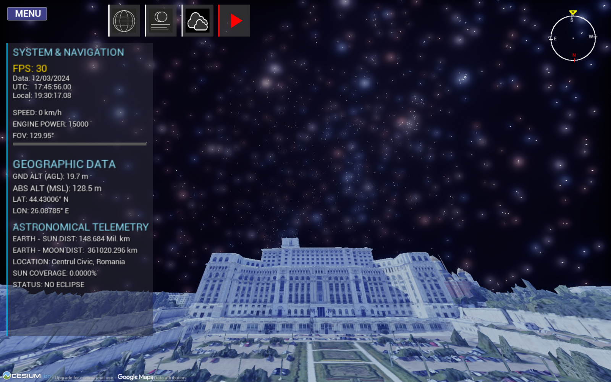

<div align="center">

# 🌑 Eclipse Simulator 3D

### See the geometry of an eclipse — not just a shaded band on a map.

**Real-time 3D solar eclipse simulator** built with **Unreal Engine 5**, a **Python / Skyfield** backend (**JPL DE441** ephemerides) and **Cesium** photorealistic terrain.
It renders the **umbra and penumbra as physical 3D cones** sweeping across a WGS84 Earth, computes **C1–C4 contact times to within ~1–1.5 s** of the reference, and covers **71,264 solar eclipses from 13,000 BC to 17,000 AD**.

[](https://www.unrealengine.com/)
[](https://www.python.org/)
[](https://rhodesmill.org/skyfield/)
[](https://cesium.com/)
[](#-requirements)

[▶ Demo Video 1](YOUTUBE_LINK_1) · [▶ Demo Video 2](YOUTUBE_LINK_2) · [⬇ Gumroad](GUMROAD_LINK) · [🎮 itch.io](ITCH_LINK)

<!-- Replace with your best screenshot / GIF -->


</div>

---

## 📖 Table of Contents

- [Why this project?](#-why-this-project)
- [Features](#-features)
- [Gallery](#-gallery)
- [Demo videos](#-demo-videos)
- [Download](#-download)
- [Getting started (build from source)](#-getting-started-build-from-source)
- [How it works](#-how-it-works)
- [Validation & accuracy](#-validation--accuracy)
- [Comparison with other tools](#-comparison-with-other-tools)
- [Limitations](#-limitations)
- [Roadmap](#-roadmap)
- [Project timeline](#-project-timeline)
- [Credits & acknowledgements](#-credits--acknowledgements)
- [License](#-license)

---

## 🎯 Why this project?

Most tools available to researchers, educators and eclipse chasers are limited to **2D maps with shaded bands** or **tables of contact times**. What is largely missing is a way to *actually see* the geometry of an eclipse: the umbra and penumbra as three-dimensional cones sweeping across a real, geographically accurate Earth.

Eclipse Simulator 3D combines, to the best of my knowledge for the first time in this form:

1. the real-time graphics of **Unreal Engine 5**,
2. geospatial, photorealistic terrain from **Cesium**,
3. the astronomical precision of the **JPL DE441** ephemerides.

It started as my Bachelor's thesis at the **Faculty of Automatic Control and Computers, National University of Science and Technology Politehnica Bucharest** (thesis: *"Real Shadow Cones Produced During the Central Solar Eclipse"*), and is now released as open source.

---

## ✨ Features

- 🌍 **All four eclipse types** — total, annular, hybrid and partial — classified purely from geometry, not hard-coded rules.
- 🔺 **True 3D umbra & penumbra cones**, with the Earth modeled as a **WGS84 ellipsoid** (not a sphere), so the equatorial bulge is accounted for.
- 🛣️ **Path of totality / annularity rendered as a real 3D band** on Cesium terrain (not a flat 2D overlay).
- ⏱️ **Precise contact times C1–C4** (with altitude and azimuth for each), computed by iterative root-finding. Handles edge cases such as **sunset before C4**.
- 📚 **71,264 solar eclipses over 30,000 years** (13,000 BC → 17,000 AD), built on the John Irwin 2021 catalogue, with a searchable/sortable catalogue browser.
- ⭐ **Accurate night sky**: 5,079 naked-eye stars (magnitude < 6) from HYG 4.2, constellation lines, names and mythological artwork.
- 🪐 **Beyond Earth–Moon**: planets and major moons (Galilean moons, Titan, Triton…) tracked with the same DE441 ephemerides.
- 🚁 **Drone camera & free flight** from space down to street level with no loading screens, ~60 FPS.
- 🕒 **Time control panel** — calendar, UTC / solar time, play, pause, rewind, speed multipliers.
- 🔖 **Saved locations (bookmarks)** with notes, date/time, GPS coordinates, zoom and tracking settings.
- 🎨 **Visual effects & atmosphere**: bloom, corona, exposure, clouds, fog, rain and snow — independent of the astronomical computation.
- 🌐 **Bilingual UI/reports**: English and Romanian.
- 🧪 **Validated against Xavier Jubier's** eclipse maps: ≤ 1 s (2026) and ≤ 1.5 s (2027) on C1–C4.

---

## 🖼️ Gallery

<!-- Put your images in docs/images/ and update the file names below -->

| Totality path & shadow cone | Totality from the ground |
|---|---|
|  |  |
| **3D globe with totality band** | **Catalogue browser** |
|  |  |
| **Annular "ring of fire" (Istanbul, 2030)** | **Night sky & constellations** |
|  |  |

> 📷 The real-life photos of the **12 August 2026** total eclipse (Zaragoza, Sant Elm – Mallorca) were taken by the author.

---

## 🎬 Demo videos

| | |
|---|---|
| **Demo 1** — TITLE | [](YOUTUBE_LINK_1) |
| **Demo 2** — TITLE | [](YOUTUBE_LINK_2) |

### What the demos show

| Scenario | Highlights |
|---|---|
| **13,000 BC** total eclipse | Extreme historical case; catalogue → teleport → drone flight to maximum totality, telemetry, contact table |
| **11 Aug 1999** | Totality over Europe; "what if it had passed over Bucharest" |
| **12 Aug 2026** | Iceland → northern Spain, diamond-ring effect, extra *Sunset* row in the contact table |
| **2 Aug 2027 (Luxor)** | 6 min 20 s totality, Nile, custom umbra/penumbra colors |
| **1 Jun 2030 (annular)** | Ring of fire over Istanbul, Time Control panel, near-apogee Moon |
| **Year 16,998** | Far-future eclipse, sunset with partial eclipse over the US west coast |
| **Solar system** | Jupiter's moons, Triton, Mercury — tracked live via DE441 |
| **Sky, effects, weather, bookmarks** | Overlays, mythological constellations, clouds/rain/snow, saved locations |

---

## ⬇️ Download

Don't want to build from source? Grab a ready-to-run build:

- 🛒 **Gumroad:** [GUMROAD_LINK](GUMROAD_LINK)
- 🎮 **itch.io:** [ITCH_LINK](ITCH_LINK)

---

## 🚀 Getting started (build from source)

### 🧰 Requirements

- Windows 10/11 with a DirectX 12-capable GPU
- **Unreal Engine 5** (VERSION — e.g. 5.x) with the **Cesium for Unreal** plugin
- **Visual Studio** with the *Game development with C++* workload
- **Python 3.x** (for the backend and ephemerides downloader)
- ~5 GB of free disk space for ephemerides (DE441 is 3.2 GB)
- A free **Cesium ion** access token (the app asks for it on first run)

### 📦 Installation

**1. Clone the repository**

```bash
git clone https://github.com/Dragos112358/Eclipse-Simulator-3D.git
cd Eclipse-Simulator-3D
```

**2. Add the Encoder runtime**

Go to the [**Releases**](https://github.com/Dragos112358/Eclipse-Simulator-3D/releases) page, download
[`Eclipse-Simulator-Encoder-win64.zip`](https://github.com/Dragos112358/Eclipse-Simulator-3D/releases/download/v1.0.0/Eclipse-Simulator-Encoder-win64.zip),
unzip it and copy its contents into the **repository root**.
This creates the `Content/Encoder/_internal` folder, which is required for the server to run correctly.

**3. Download the ephemerides**

```bash
python3 Download_Ephemerides/Downloader.py
```

> ⏳ `de441.bsp` is **3.2 GB**, so it is downloaded in **two parts** and then merged with `spkmerge`.
> This can take **up to an hour**, depending on your machine and internet connection.
> The script also downloads a high-quality Moon texture.

**4. Generate the Visual Studio project files**

Right-click **`Proiect_Eclipsa.uproject`** → **Generate Visual Studio project files**.

**5. Build and edit**

Open the generated **`.sln`** file in Visual Studio to build, modify and edit the code.

### 🔧 Running the backend server

The Python backend lives in the [`Server/`](Server) folder (see `requirements.txt` there):

```bash
pip install -r Server/requirements.txt
```

<!-- TODO: add the exact command that starts the server (e.g. python Server/main.py) -->

---

## 🧠 How it works

### Two-tier architecture

```
┌────────────────────────────┐   UDP, 80 B request / frame    ┌──────────────────────────────┐
│  Unreal Engine 5 (C++)     │ ─────────────────────────────▶ │  Python backend              │
│  Rendering · UI · Cesium   │                                │  Skyfield · DE441 · geometry │
│  Drone camera · VFX        │ ◀───────────────────────────── │  Multithreaded               │
└────────────────────────────┘   UDP, 3,700 B response / frame└──────────────────────────────┘
```

- **Python** is the computational backend, **Unreal Engine 5** the rendering frontend.
- They talk over **UDP**: the backend streams fresh celestial positions every frame, and a dropped packet is simply superseded by the next one a few milliseconds later — so TCP's retransmission/ordering would only add latency.
- The backend is **multithreaded**: the main thread computes body positions every frame and must never block; a secondary thread handles heavy or high-latency work (iterative contact-time root-finding, GeoPy location lookups).

### Computation pipeline

1. **Time synchronization** — `finals2000A.all` Earth Orientation Parameters for ΔT, shared by Python and C++.
2. **Ephemerides** — JPL **DE441** loaded through Skyfield (Sun, Moon, Earth, planetary barycenters).
3. **Shadow vector (cone axis)** — `z_dir` derived from apparent Sun/Moon coordinates, transformed to **ITRS** (Earth-fixed).
4. **Intersection modeling** — a quadratic equation gives the entry/exit points of the umbra/penumbra cones on the **WGS84 ellipsoid**.
5. **Contact times C1–C4** — iterative root-finding.

### Fixed-layout binary packets

| Direction | Format | Size | Content |
|---|---|---|---|
| Python → Unreal | `350d900s` | **3,700 B** | Sun/Moon positions, coverage & magnitude, sidereal time, planets & moons, 200 lat/lon path points + path widths, live shadow position, 900-byte report text |
| Unreal → Python | `10d` | **80 B** | Date/time (with sub-minute precision), observer lat/lon/alt (WGS84), language flag (0 = RO, 1 = EN) |

A fixed binary layout (instead of JSON) lets Unreal read every field by byte offset with zero parsing overhead, sixty times a second.

### Time scale & calendars

- ΔT uses the **Espenak & Meeus** piecewise polynomials, implemented identically in Python and C++ to avoid round-trip timing errors for ancient dates.
- Skyfield uses the *proleptic Gregorian* calendar, while the Irwin catalogue reports ancient dates in the *Julian* calendar. This divergence is handled explicitly, otherwise an ancient eclipse could be mis-dated by days.

---

## ✅ Validation & accuracy

Contact times were compared with **Xavier Jubier's interactive eclipse maps**, the community reference:

| Eclipse | Max. difference on C1–C4 |
|---|---|
| Total — **12 Aug 2026** | **≤ 1 s** |
| Total — **2 Aug 2027** (Luxor) | **≤ 1.5 s** |

Additional case studies (July 2010 Chile, May 2079 USA, 13,000 BC Canada, 16,995 AD Australia) show the same model — ΔT, DE441, cone geometry — behaving consistently over the entire 30-millennium range.

The catalogue was also cross-checked with a Besselian-elements script: **719 eclipses** had totality/annularity touching Romania across 30,000 years, and the 11 Aug 1999 track matched the documented path.

---

## 🆚 Comparison with other tools

| Feature | **Eclipse Simulator 3D** | Stellarium | Celestia | SpaceEngine | The Photographer's Ephemeris | Jubier's website |
|---|:---:|:---:|:---:|:---:|:---:|:---:|
| Renders umbra/penumbra **cones in 3D** | ✅ | ❌ | ❌ | ❌ | ❌ | ❌ |
| 3D real-terrain rendering | ✅ | — | partial | partial | — | ❌ (2D) |
| Time range | **13,000 BC – 17,000 AD** | wide | wide | wide | ~19 years (free) | ~50 years |
| Timing accuracy (2017 US eclipse / vs Jubier) | **0.1 – 20 s** | ~8 min offset | — | — | — | reference |

*(Summarized from the thesis' comparison table; see the thesis for methodology.)*

---

## ⚠️ Limitations

- **ΔT extrapolation**: at the extremes of the range (≈13,000 BC / 17,000 AD) the true uncertainty in Earth's rotation is measured in **hours**. Those results are *geometrically consistent*, not validated to sub-second precision like 2026/2027.
- **Lunar limb**: the basic shadow model assumes a smooth limb; real lunar topography can shift contact times by a few seconds.
- **DE441** integration uncertainty grows modestly toward both ends of its range.

---

## 🗺️ Roadmap

- [x] All four solar eclipse types, 3D cones on WGS84, contact times C1–C4
- [x] 30,000-year catalogue browser (71,264 solar eclipses)
- [x] Solar-system expansion (planets & moons)
- [x] Lunar eclipse support
- [x] Lunar limb (topographic profile) modeling
- [ ] Live weather / cloud-cover forecasts along the totality band
- [ ] Optimal route planning for eclipse chasers
- [ ] VR headset deployment
- [ ] Planetarium integration

---

## 🕰️ Project timeline

<!-- Fill in the dates you are comfortable sharing -->

| When | Milestone |
|---|---|
| DATE | Project started — first Skyfield ↔ Unreal UDP prototype |
| DATE | 3D umbra/penumbra cones and WGS84 intersection |
| DATE | Cesium integration, 3D totality band |
| DATE | Eclipse catalogue (71,264 events) and browser UI |
| DATE | Solar-system expansion, sky overlays, weather effects |
| **May 2026** | Presented at a student scientific session — **honorable mention** |
| **Jul 2026** | Bachelor's thesis completed (Politehnica Bucharest) |
| **12 Aug 2026** | Total eclipse over Iceland & Spain — validation and personal photography |
| **2027** | Open-source release — v1.0 |

---

## 🙏 Credits & acknowledgements

**Author:** Boncan Dragoș-Eduard-Gabriel — [GitHub @Dragos112358](https://github.com/Dragos112358)

**Scientific advisors:** Assoc. Prof. **Victor-Iosif Asavei**, Lecturer **Florin-Cătălin Tudose**, astronomer **Cătălin Beldea**.

**Data, libraries and tools**

- 🌐 [**Skyfield**](https://rhodesmill.org/skyfield/) — high-precision astronomy in Python
- 🪐 [**JPL DE441**](https://naif.jpl.nasa.gov/naif/) ephemerides — NASA Jet Propulsion Laboratory
- 📜 **John Irwin**, *Thirty Millennium Catalog of Solar and Lunar Eclipses* (2021)
- ⭐ **HYG 4.2** star database
- 🧮 **Espenak & Meeus** ΔT polynomials (NASA)
- 🗺️ [**Cesium for Unreal**](https://cesium.com/platform/cesium-for-unreal/) — photorealistic 3D terrain
- 🎮 [**Unreal Engine 5**](https://www.unrealengine.com/) — Epic Games
- 📍 **GeoPy** — reverse geocoding
- ✅ [**Xavier Jubier**](http://xjubier.free.fr/) — eclipse maps used as the validation reference
- 🔭 Compared against: Stellarium, Celestia, SpaceEngine, The Photographer's Ephemeris

<!-- Add Moon texture / asset credits here -->

---

## 📄 License

<!-- Choose a license and add a LICENSE file, e.g. MIT -->
Distributed under the **LICENSE_NAME** license. See [`LICENSE`](LICENSE) for details.

Third-party data and assets (Irwin catalogue, HYG, DE441, Cesium, Unreal Engine) are subject to their own licenses and terms.

---

<div align="center">

⭐ If you like this project, please **star the repo** and share it with fellow eclipse chasers! ⭐

*Next total solar eclipse: 2 August 2027 — see you in Luxor? 🌑*

</div>